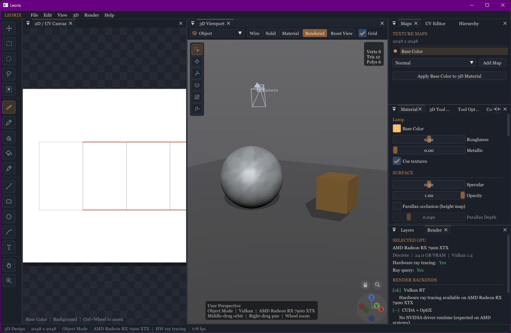
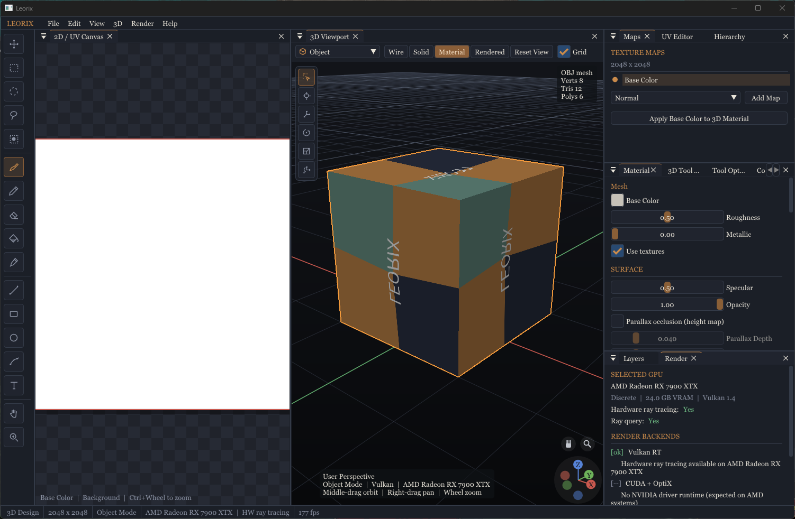
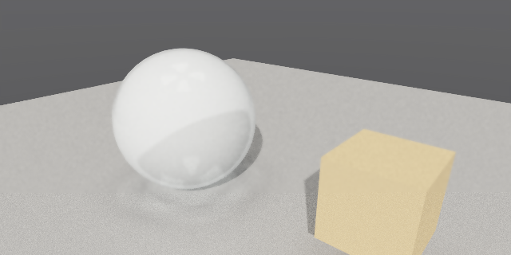
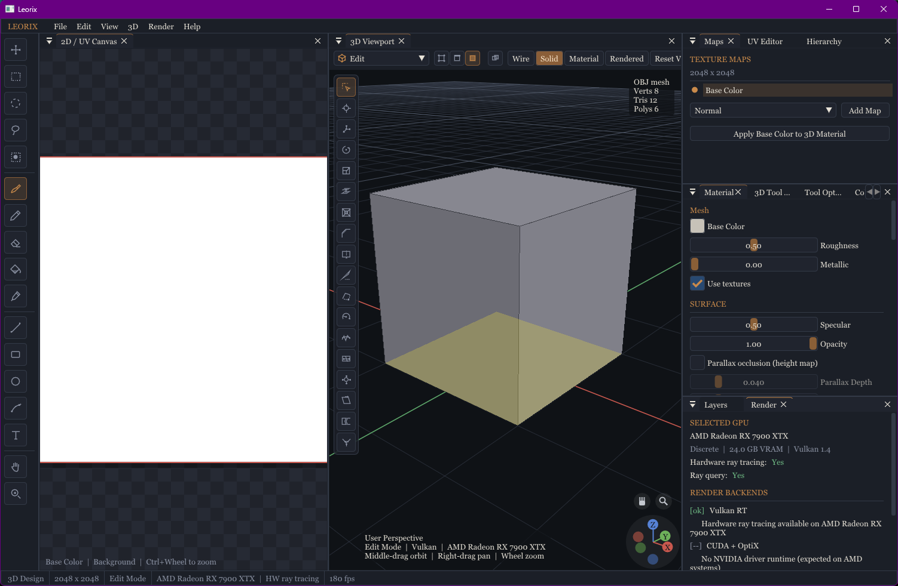
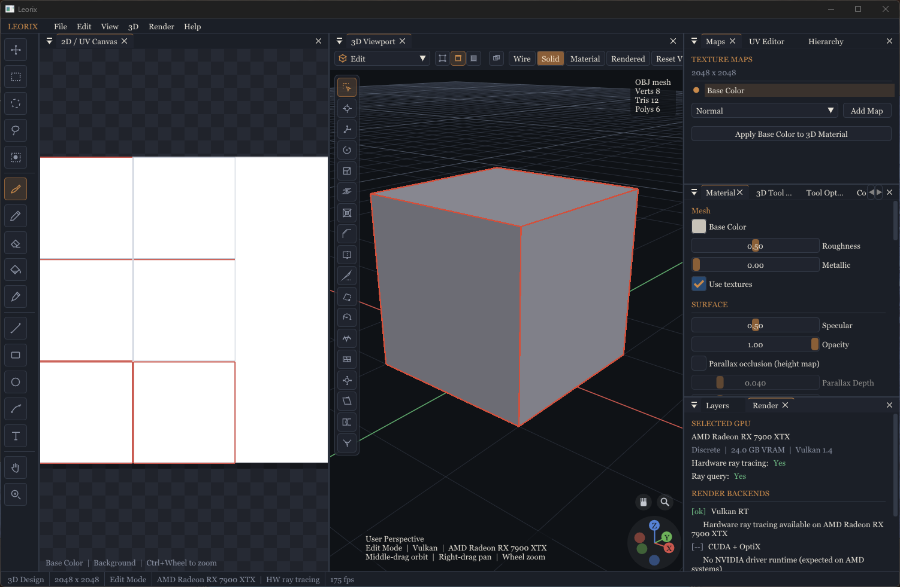
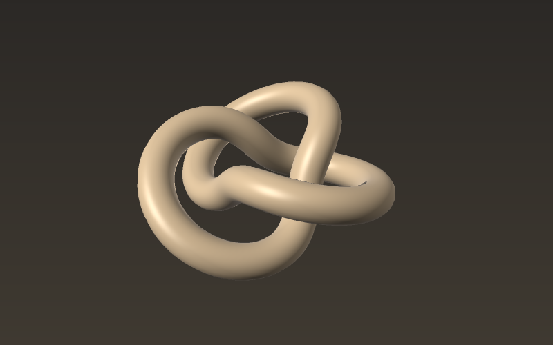

<h1 align="center">Leorix Native</h1>

<p align="center">
  <b>A native 3D modelling, texturing and rendering suite, written from scratch in C++20 on Vulkan.</b>
</p>

<p align="center">
  
  
  
  
  
  <a href="LICENSE"></a>
</p>

<p align="center">
  
</p>

Leorix Native is a desktop app for building, texturing, rigging and rendering 3D models. It ships as a
single self-contained `.exe`. It has a Blender-style workflow, a CPU path tracer, a layered PBR
texture painter and a sandboxed Lua scripting API.

## Highlights

- **Vulkan renderer and app shell.** Picks the discrete GPU automatically and detects render backends. The UI is a dockable Dear ImGui layout with a custom theme and vector icons.
- **Mesh pipeline.** Imports OBJ, FBX (binary and ASCII), glTF/GLB and USDA, and exports OBJ, glTF, GLB and USDA. Quads and n-gons survive the round trip. Normals are oriented automatically on import.
- **Blender-style editing.** Object and Edit Mode, with vertex, edge and face selection and box select. Extrude, Delete and Merge at Center that keep quads and UVs intact. Grab, rotate and scale with axis constraints, snapping, Join, and Shift+D duplicate.
- **Non-destructive modifier stack.** 13 modifiers, including Subdivision Surface (Catmull-Clark), Mirror, Array, Solidify, Shrinkwrap, Screw, Voxel Remesh, Decimate and Curve Deform, previewed live.
- **Sculpting.** 23 brushes (Draw, Clay Strips, Inflate, Crease, Smooth, Flatten, Scrape, Pinch, Grab, Snake Hook, Elastic and more) with nine falloff curves, X/Y/Z symmetry, auto-smooth, custom image stamps, multiresolution layers and one undo step per stroke.
- **UV tools.** Mark seams, unwrap islands with LSCM and pack them into the 0..1 square.
- **Texture painting.** 11 PBR map kinds, each with its own layer stack, and 16 blend modes (including Hue, Saturation, Color and Luminosity). Undo stores only the 128×128 tiles a stroke touched.
- **Path tracer.** Multithreaded CPU tracer with BVH acceleration, glass with Fresnel, emissive materials, parallax occlusion mapping, next-event estimation with multiple importance sampling for area lights, tangent-space normal mapping, an edge-aware denoiser and eight procedural HDRI environments.
- **Rigging and animation.** Armatures with automatic weights, Pose Mode, and a keyframe timeline with Bezier interpolation and nine easing curves.
- **Visual scripting for beginners.** Snap together plain-English blocks (Box, Ball, Copy in a Circle, Put Together...) with colour-coded wires; every block explains itself.
- **Lua scripting.** Build meshes procedurally in a sandbox with no file, OS or network access, with instruction and memory limits so a runaway script can't freeze the app.
- **Project files.** `.leorix` is a ZIP container with a JSON manifest and per-layer PNGs, and round-trips without loss.
- **Command-line tools.** Headless format conversion and a self-test run by CTest (primitives, OBJ round trip, edit ops, sculpt, undo and path-tracer convergence checks), plus render-to-PNG at startup.

## Gallery

| Material Preview | Path-traced render |
|:---:|:---:|
|  |  |
| **Edit Mode: face selection** | **UV unwrap with seams** |
|  |  |

<p align="center">
  <br>
  <sub>A torus knot built entirely from a Lua script. See the <a href="docs/SCRIPTING.md">scripting guide</a>.</sub>
</p>

## Tech stack

| Area | Technology |
|---|---|
| Language | C++20 (C for vendored single-file libraries) |
| Graphics | Vulkan 1.3 via [volk](https://github.com/zeux/volk), so no Vulkan SDK is needed at build or run time |
| Windowing and input | SDL3 |
| UI | Dear ImGui (docking branch) |
| Mesh I/O | tinyobjloader, ufbx, tinygltf |
| Images and archives | stb_image, stb_image_write, miniz |
| Scripting | Lua 5.4 (embedded, sandboxed) |
| Build | CMake 3.24+, Ninja, WinLibs MinGW-w64 (no Visual Studio needed) |

CMake `FetchContent` downloads all dependencies on the first configure.

## Documentation

- **[How it's made](docs/ARCHITECTURE.md)**: architecture, the mesh data model, the renderer and path tracer, the file formats, and the design decisions behind them.
- **[Procedural Generation tutorial book (Word)](docs/Leorix_Procedural_Scripting_Guide.docx)**: 51 illustrated tutorials, from visual blocks to Lua-built cities, landscapes, animation frames and generators. The scripts are in [docs/tutorials/lua](docs/tutorials/lua).
- **[Visual scripting guide](docs/VISUAL_SCRIPTING.md)**: build models with blocks, no coding needed.
- **[Scripting guide](docs/SCRIPTING.md)**: the Lua API reference, examples and advanced techniques.
- **[Feature parity map](PARITY.md)**: what's done, what's partial and what's planned.

## Quick start

**Run:** double-click `leorix.exe`. It's prebuilt, statically linked and needs no install.

**Build** (Windows PowerShell with WinLibs MinGW):

```powershell
cmake -S . -B build -G Ninja -DCMAKE_BUILD_TYPE=Release
cmake --build build
.\build\leorix.exe
```

**Test:**

```powershell
cd build; ctest --output-on-failure
```

### Command line

```text
leorix.exe --open model.fbx                 open a mesh at startup
leorix.exe --brush stamp.png                load a custom sculpt brush image
leorix.exe --convert in.fbx out.glb         headless format conversion
leorix.exe --open model.obj --hdri env.hdr --render out.png
                                            open, path-trace to PNG, then quit
leorix.exe --selftest                       run the headless self-test suite
```

## File formats

| | Formats |
|---|---|
| Import | OBJ, FBX (binary and ASCII, Blender and Maya), glTF, GLB, USDA |
| Export | OBJ, glTF, GLB, USDA |
| Project | `.leorix`: a ZIP holding `manifest.json` and `layers/L{ID}_{Map}.png` |
| Images | PNG, JPG and other stb_image formats; `.hdr` equirectangular environments |

glTF is a triangle-only format by spec, so a mesh exported as glTF comes back triangulated. Binary
USDC is detected and reported; re-export it as USDA.

<details>
<summary><b>Controls and shortcuts</b></summary>

```text
Navigation      Middle-drag orbit, right-drag pan, wheel zoom
                Alt+LMB / Alt+Shift+LMB / Alt+Ctrl+LMB for trackpads and pens
Views           Numpad 1 / 3 / 7 front / right / top (Ctrl for the opposite side)
                Numpad 5 ortho/perspective, Numpad 0 camera view, Numpad . frame selected
Modes           Tab Edit Mode, Ctrl+Space cycles Object > Sculpt > Edit > Retopology > Pose
Edit Mode       1 / 2 / 3 vertex / edge / face, E extrude, X delete, M merge,
                U unwrap, drag to box select
Transform       G / R / S with X / Y / Z constraints, Esc cancels, Ctrl toggles snapping
Objects         Shift+A add, Shift+D duplicate, Ctrl+J join
Textures        Shift+T loads a texture set and sorts files into slots by name
Render          F12 render image
Animation       I insert keyframe
Files           Ctrl+N new, Ctrl+O open, Ctrl+S save, Ctrl+Z / Ctrl+Shift+Z undo / redo
Workspaces      F1 both, F2 focus 2D, F3 focus 3D
```
</details>

<details>
<summary><b>Primitive topology (matches Blender's Add Mesh defaults)</b></summary>

```text
Plane      4 v / 1 face       Cube       8 v / 6 faces      Circle    32 v / 1 face
UV Sphere  482 v / 512        Ico Sphere 42 v / 80          Cylinder  64 v / 34
Cone       33 v / 33          Torus      512 v / 512        Grid      121 v / 100
```

Quads stay quads. The mesh is triangulated only for drawing, and every triangle remembers its
polygon, so the wireframe, edge selection and OBJ/USDA export all work on the real faces. These
counts are checked by `--selftest`.
</details>

## Roadmap

Planned work includes a GPU (Vulkan RT) path tracer backend, per-pixel PBR maps in the viewport,
cloth and rigid-body simulation, bone constraints and IK, 2.5D diorama scenes and a webcomic mode.
The full list is in [PARITY.md](PARITY.md).

## Author

Designed and built by **Charlize Pauli**.

## License

Released under the [MIT License](LICENSE). © 2026 Charlize Pauli.
