# How Leorix is made

Leorix is designed and built by **Charlize Pauli**.

This document is a technical tour of Leorix Native: why it exists, how the pieces fit together,
and the engineering decisions behind each subsystem. It describes the code as it is, and points
out where something is still a simplification.

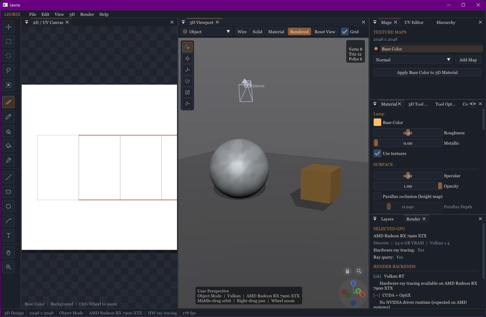

---

## Contents

1. [Goals and history](#1-goals-and-history)
2. [Tech stack](#2-tech-stack)
3. [Module map](#3-module-map)
4. [Startup, Vulkan and the frame loop](#4-startup-vulkan-and-the-frame-loop)
5. [The mesh data model](#5-the-mesh-data-model)
6. [Import and export](#6-import-and-export)
7. [The 3D viewport](#7-the-3d-viewport)
8. [Edit operators, sculpting, modifiers and animation](#8-edit-operators-sculpting-modifiers-and-animation)
9. [The CPU path tracer](#9-the-cpu-path-tracer)
10. [Texture painting](#10-texture-painting)
11. [The .leorix project container](#11-the-leorix-project-container)
12. [Undo and redo](#12-undo-and-redo)
13. [UV unwrapping](#13-uv-unwrapping)
14. [Scripting](#14-scripting)
15. [Testing and the build](#15-testing-and-the-build)
16. [Contributor notes: extending Leorix](#16-contributor-notes-extending-leorix)

---

## 1. Goals and history

Leorix started as an Electron app: a texture painter with 2D, 2.5D, webcomic and 3D modes,
written in HTML/JS. Leorix Native is a ground-up rewrite of that app in C++20.

The reasons for going native:

- **The right GPU.** On dual-GPU laptops, Electron often landed on the integrated chip. The
  native app enumerates every Vulkan device and scores them itself (see [§4](#4-startup-vulkan-and-the-frame-loop)).
- **Mesh scale.** The 3D side is designed for ZBrush-scale vertex counts: indexed geometry,
  selections stored as index sets, adjacency built lazily only when a tool needs it.
- **Real rendering.** A multithreaded CPU path tracer renders the scene with the same materials
  and environment the viewport shows. GPU ray tracing is detected and planned.
- **One file to ship.** The whole app is a single statically linked `leorix.exe`. You don't
  need to install anything to run it, and building it doesn't need the Vulkan SDK or Visual Studio.

The interaction model deliberately follows Blender: the same primitive defaults, G/R/S modal
transforms, vertex/edge/face select modes, seams and sharp edges, modifier stacks and
F-curve-style keyframes. Artists who know Blender can feel at home right away.

[PARITY.md](../PARITY.md) tracks feature parity with the Electron app, item by item.

---

## 2. Tech stack

| Concern | Choice | Why |
|---|---|---|
| Language | C++20 | Performance, direct control of memory layout for big meshes |
| Window, input, dialogs | **SDL3** (static) | Cross-platform windowing, high-DPI, native file dialogs |
| GPU API | **Vulkan 1.3** through **volk** | volk loads `vulkan-1.dll` at runtime, so building needs only the headers, not the SDK |
| UI | **Dear ImGui** (docking branch) with SDL3 + Vulkan backends | Dockable editor layout, multi-viewport, immediate mode keeps tool UIs short |
| FBX import | **ufbx** | Single-file, robust with Blender and Maya files, binary and ASCII |
| glTF / GLB | **tinygltf** | Header-only, reads and writes both variants. It also ships `nlohmann/json`, which the project format reuses |
| OBJ | **tinyobjloader** | Polygon-preserving load (triangulation turned off) |
| Scripting | **Lua 5.4** (built from `onelua.c`) | Tiny to embed, easy to sandbox, friendly for artists |
| Project container | **miniz** | ZIP read/write for `.leorix` files |
| Images | **stb_image** / **stb_image_write** | PNG/JPG/HDR in, PNG out |
| Build | CMake ≥ 3.24 + Ninja, **WinLibs MinGW** | No Visual Studio needed. `-static` produces one self-contained exe |

All dependencies are **pinned** (release tags, or commit hashes for ImGui and stb), and CMake's
`FetchContent` downloads them on the first configure. After that, builds work offline.

---

## 3. Module map

```
src/
├── main.cpp           entry point: CLI modes, SDL window, Vulkan swapchain, frame loop
├── app/               the editor shell: panels, menus, workspaces, theme, icons
├── viewport/          3D viewport camera/grid/gizmo + software mesh rasterizer and picking
├── mesh/              Mesh, Scene, primitives, import/export, modifiers, multires, UV unwrap
├── render/            materials, CPU path tracer, HDRI presets, GPU backend detection
├── paint/             2D maps, layer stacks, blend modes, brushes, .leorix project I/O
├── anim/              armatures, skinning, keyframe animation
├── tools/             Lua scripting, sculpt brush images, tool catalogs, modal transform op
├── gpu/               Vulkan context, GPU textures
└── core/              undo/redo stack
```

Include dependencies between modules (an arrow means "includes headers from"):

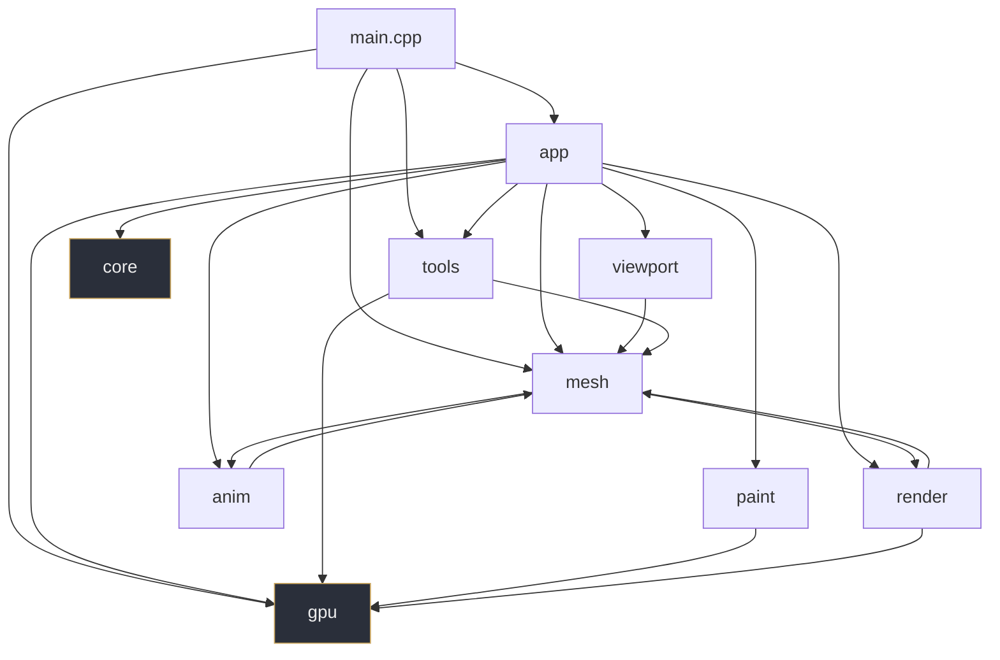

`mesh` and `render` refer to each other on purpose: a `MeshObject` in the scene owns its
`Material`, and the tracer reads the scene. `core` and `gpu` are leaves with no
dependencies on the rest of Leorix.

The `App` class (`app/App.h`) is the shell. `App.cpp` holds the 2D/paint/UV side,
and `App3D.cpp` holds the 3D editor: object and edit modes, tools, panels for modifiers,
materials, environment, camera, render and animation. Workspaces (`Texture2D`, `Design3D`,
`Creation3D`, `Animation3D`, `Render3D`, `Webcomic`, `Scene25D`) rearrange the same panels.

---

## 4. Startup, Vulkan and the frame loop

### Device selection

`VulkanContext::Init` (`gpu/VulkanContext.cpp`) calls `volkInitialize()`, creates a Vulkan 1.3
instance with the extensions SDL needs, then enumerates **every** physical device into
`allGpus`, so the UI can show which card was picked and why. Each device gets a score:

```
score = (Discrete ? 10^12 : Integrated ? 10^11 : 0)
      + (VK_KHR_acceleration_structure && VK_KHR_ray_tracing_pipeline ? 10^10 : 0)
      + VRAM in MiB
```

So a discrete GPU always beats an integrated one. Among equals, hardware ray tracing wins,
then the larger VRAM. `render/Backends.cpp` separately probes for Vulkan RT, CUDA/OptiX and
AMD HIP runtimes and reports what is installed.

### Startup sequence

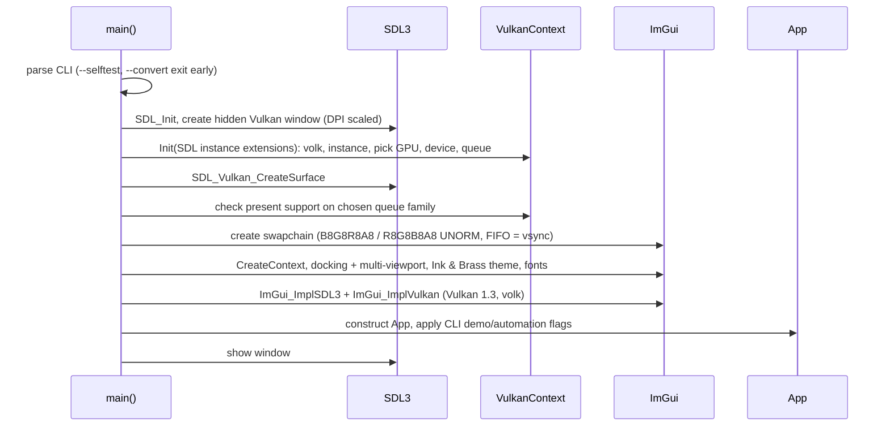

### Frame loop

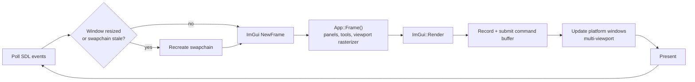

`FramePresent` treats `VK_ERROR_OUT_OF_DATE_KHR` and `VK_SUBOPTIMAL_KHR` as "rebuild the
swapchain next frame" instead of failing. While the window is minimized, the loop sleeps
instead of spinning. On shutdown, the `App` is destroyed *before* the ImGui Vulkan backend, so
the GPU textures it owns are released while their descriptor pool still exists.

### Headless and automation modes

The same executable doubles as a command-line tool:

| Flag | Effect |
|---|---|
| `--selftest` | Runs the self-test suite and exits with 0 or 1 (used by CTest) |
| `--convert in out` | Headless mesh format conversion |
| `--open mesh [--mode n]` | Opens a mesh in a given workspace |
| `--tex file` (repeatable) | Loads texture maps, slot guessed from the file name |
| `--shading 0..3` | Wireframe / Solid / Material / Rendered |
| `--hdri file` / `--hdripreset n` | Environment lighting |
| `--sun deg` / `--exposure x` | Sun elevation and exposure |
| `--samples n` + `--render out.png` | Path trace to a PNG, then quit (batch rendering) |
| `--brush image` | Loads a sculpt brush stamp |
| `--uv 1` | Opens the UV editor |

---

## 5. The mesh data model

`mesh/Mesh.h` defines the one mesh type the whole 3D side works on.

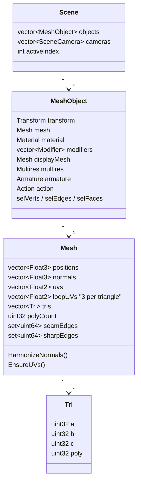

### Polygons on top of triangles

Everything that draws or ray-traces wants triangles. Everything an artist touches wants quads.
Leorix stores **triangles that remember their polygon**: every `Tri` carries a `poly` id. That
gives you:

- **Quad wireframes.** `MeshObject::BuildTopology` collects `polyEdges` (edges on a polygon's
  boundary) and `diagonals` (internal triangulation edges). Diagonals are never drawn and never
  selectable, matching Blender.
- **Face selection by polygon.** `selFaces` holds polygon ids, not triangle ids.
- **Lossless round trips.** The OBJ and USDA exporters group triangles by `poly` and
  rebuild each n-gon's vertex ring, so a quad that came in goes out as a quad.

Primitives are built the same way, and their counts match Blender's Add Mesh defaults exactly
(cube: 8 verts / 6 faces, UV sphere: 482 / 512, and so on). The self-test checks those counts.

### Per-face-corner UVs

`loopUVs` holds **three UVs per triangle**, one per corner. This is how Blender stores UVs:
a UV seam doesn't split the vertex, so a textured cube stays 8 vertices instead of 24, and
edit-mode topology stays intact. `HasLoopUVs()` is simply `loopUVs.size() == tris.size() * 3`.
`EnsureUVs()` falls back to a spherical projection for meshes that arrive without UVs, so
Material Preview always has something to sample.

> **Invariant for anyone writing a topology operator:** any operation that changes the
> vertex or triangle count (extrude, delete, merge, subdivide) must rebuild `loopUVs` **in the
> same loop, at the same indices** as it rebuilds `positions` and `tris`. If it doesn't, the
> UV-seam and wireframe code read past the end or compare against garbage, and every edge
> starts looking like a seam.

### Automatic normal orientation

There is no "Recalculate Normals" button, because every mesh entering the scene
(`Scene::AddMesh`, and every importer) runs `Mesh::HarmonizeNormals()`:

1. Build an edge → triangles map that records the direction each triangle walks each edge.
2. Flood-fill each connected shell. Two neighbours agree when they traverse their shared edge in
   **opposite** directions. A neighbour that walks it the same way is flipped.
3. Compute each shell's **signed volume**. If it's negative, the shell is inside out and is flipped as a whole.
4. Only the triangles that actually turned around get their corner UVs reordered. Swapping all
   of them would corrupt faces that were already correct.

Edge flags (`seamEdges`, `sharpEdges`) are keyed by `EdgeKey(a, b)`, which packs `(min, max)`
vertex indices into one `uint64_t`, the same scheme as Blender's edge flags.

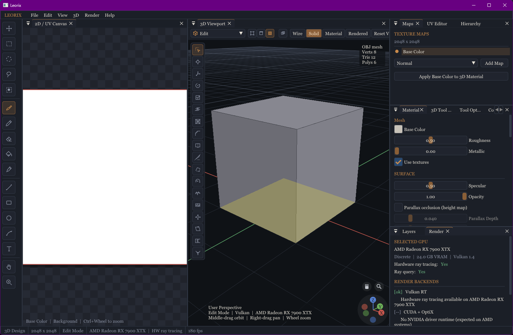

---

## 6. Import and export

`mesh/IO.cpp` dispatches on the file extension:

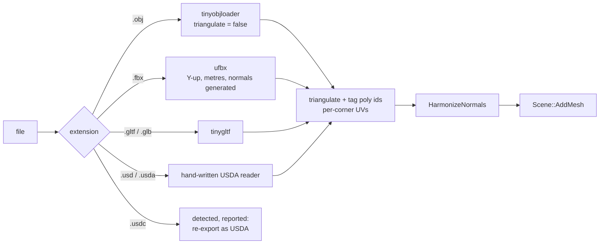

| Format | Import | Export | Notes |
|---|---|---|---|
| OBJ | ✅ | ✅ | One vertex per OBJ position, so file counts are preserved exactly. Quads and n-gons round-trip |
| FBX | ✅ binary + ASCII | — | ufbx converts to right-handed Y-up, metres. Export isn't implemented yet |
| glTF / GLB | ✅ | ✅ + skin + animation | glTF is triangles by spec, so a glTF round trip comes back triangulated. Rigged objects export as a skin (import reads the mesh only) |
| USDA | ✅ | ✅ | Reads `def Mesh` blocks (`points`, `faceVertexCounts`, `faceVertexIndices`) in any attribute order |
| USDC | detected | — | The binary crate format is reported with a clear message |

The USDA reader scopes each attribute lookup to its own `def Mesh` block. Blender writes counts
and indices *before* points, so searching forward from the previous match would miss them. It
also looks for values *after* the `=` sign, because a `[` appears inside the type name
(`point3f[] points`) too.

**Skinned glTF export.** A bound armature is written as a glTF skin. The mesh goes out in its bind
pose (`restPositions`), and each bone becomes a joint node at its head with no rest rotation, so the
inverse bind matrix is just a translation by `-head`. The joint's TRS is the parent-relative head plus
the pose, so `joint * inverseBind` reproduces `Armature::Evaluate` exactly; the self-test checks this
numerically. `JOINTS_0`/`WEIGHTS_0` carry the four influences, renormalised, and vertices with no
influence go to an extra still joint. Keyframes are baked once per frame into LINEAR samplers, so
Bezier and easing curves survive. Object-level keys are exported only for unrigged objects.

`leorix.exe --convert in.fbx out.glb` exposes the whole pipeline headlessly, which is also
how the importers get tested.

---

## 7. The 3D viewport

`viewport/Viewport3D` owns the orbit camera, the grid, axes, the navigation gizmo and the
pan/zoom handles. Navigation follows Blender's keymap, including Alt-based "emulate 3 button
mouse" for trackpads and tablets.

`viewport/MeshView` is a **software rasterizer that emits ImGui draw lists**. Projection and
picking happen on the CPU. The resulting triangles are batched into `ImDrawList` vertex
buffers, which the ImGui Vulkan backend draws. The projection and pick math is shared by edit
mode, sculpting and retopology.

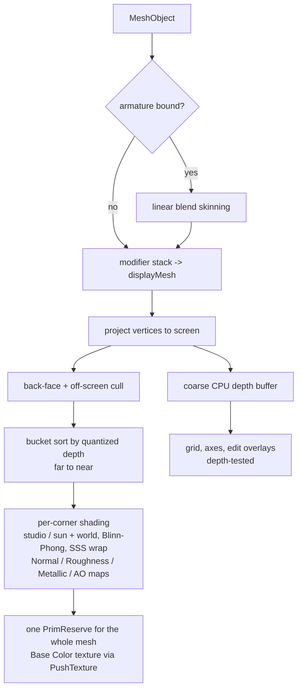

Design points:

- **Painter's algorithm, made fast.** A full `std::sort` of every triangle is the bottleneck on
  dense meshes, so the rasterizer culls first (which typically removes over half the
  triangles) and then bucket-sorts the survivors by quantized depth.
- **Raw primitives, no AA fringe.** Anti-aliased ImGui fills cost several extra triangles each.
  Flat-shaded geometry doesn't need them, so the mesh goes out in a single `PrimReserve` with three
  vertices per triangle.
- **A real depth test for overlays.** `ImDrawList` has no depth buffer, so `ViewportDepth`
  rasterizes the meshes into a half-resolution CPU depth buffer *before* the grid is drawn.
  The grid, axes, seams and edit overlays then test against it and stop drawing through solid
  geometry.
- **Shading modes.** These match Blender: Wireframe (a neon trace over a dark occluding
  shell), Solid (a studio light that follows the camera), Material Preview and Rendered (lit by
  the Environment panel's sun and world, with Base Color textures applied through
  `PushTexture` and per-corner UVs). Rendered mode adds an HDRI background, re-projected every
  frame, and a ground shadow.
- **PBR maps in the viewport.** In Material Preview and Rendered, the Normal, Roughness,
  Metallic and AO maps are sampled from their CPU copies **at each face corner** and folded
  into that corner's shade, which `ImDrawList` then interpolates across the triangle. Normal
  maps are a real tangent-space perturbation. `ComputeLoopTangents` (`mesh/Mesh.cpp`) derives a
  tangent and bitangent per face corner from `loopUVs`, so mirrored UV islands get the right
  handedness. A missing map falls back to the material's scalar value (or a flat normal, or AO 1).
  The trade-off is that map detail is limited by vertex density: it's sharp on a sculpt-scale
  mesh and soft on a low-poly cube. It will become per-pixel when a GPU fill pass replaces the
  software one.
- **Edit-mode overlays** use Blender's colours: purple selected vertices, orange edges, yellow
  faces, red seams, cyan sharp edges. There's also a Face Orientation overlay (blue front, red back).

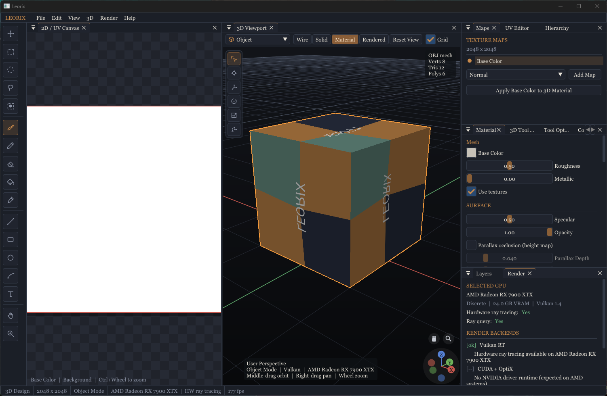

---

## 8. Edit operators, sculpting, modifiers and animation

**Edit Mode operators** (`mesh/EditOps.*`). Extrude (E), Delete (X) and Merge at Center (M)
change topology, so they're written as pure functions over the `Mesh` and return the selection
to show afterwards, in the new vertex numbering:

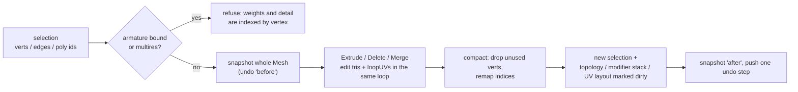

- **Extrude** works on the selected faces (or on faces whose vertices are all selected) as one
  region. New side walls are built along the region's boundary, and the region's interior
  vertices are compacted away. The new geometry sits on top of the old until a grab moves it,
  as in Blender.
- **Delete** removes the selected faces and every face that touches a selected vertex or edge,
  then removes vertices nothing uses any more.
- **Merge at Center** collapses the selected vertices to their average.
- All three keep `loopUVs` in lockstep with `tris` (see [§5](#5-the-mesh-data-model)). Polygons
  keep their triangulation and `poly` ids, so quads stay quads.

**Sculpting** (`tools/Sculpt.*`). This is a headless brush engine with no UI dependencies, so
the self-test exercises it directly. `ApplySculptDab(mesh, disp, settings, brush, dab, stamp)`
deforms either `positions` or, on a multires object, the per-vertex `displacement`, and
returns how many vertices moved.

- **Dabs are in object space.** The viewport pick point is mapped through
  `Transform::InverseApply`, and the brush radius (set in screen pixels) is converted to world
  units at the hit depth.
- **23 brushes** have a deformation engine: Draw, Draw Sharp, Clay, Clay Strips, Clay Thumb,
  Layer, Inflate, Blob, Crease, Smooth, Flatten, Fill, Scrape, Multiplane Scrape, Pinch, Grab,
  Elastic, Snake Hook, Thumb, Nudge, Polish, Planar Trim, and Custom Image (the imported
  `BrushImage` height stamp). Brushes without an engine (mask, paint, cloth, pose, ...) report
  `SculptBrushSupported() == false` and leave the mesh untouched.
- **9 falloff curves** (Smooth, Smoother, Sphere, Root, Sharp, Linear, Sharper, Inverse Square,
  Constant), plus X/Y/Z **symmetry** and axis locks. Holding Shift smooths with any brush,
  using a Laplacian neighbour average.
- **One undo step per stroke.** The positions (or displacement) are captured at stroke start,
  and `SculptStrokeEnd` pushes the before/after pair when the mouse is released.

**Modifier stack** (`mesh/Modifier.*`). This is non-destructive: the base mesh is never touched.
`EvaluateModifiers` runs the stack top to bottom into `MeshObject::displayMesh`, which is
drawn instead of `mesh`. *Apply* bakes one entry down. The 13 modifiers are Array, Mirror,
Solidify, Subdivide, Smooth, Weld, Shrinkwrap, Screw, Remesh, Displace, Triangulate, Decimate
and Curve Deform. Shrinkwrap and Curve Deform receive other scene objects as targets. Curves
are Catmull-Rom splines (`CurvePath::Evaluate`).

**Multires** (`mesh/Multires.*`). Sculpted detail is stored as a **displacement per vertex of
the subdivided cage**, not baked into the mesh. Changing the base or the level keeps the
detail that still fits.

**Armatures** (`anim/Armature.*`). Bones have a rest head/tail in object space and a parent
index, plus a pose (rotation/location/scale). Up to four weights per vertex. *Automatic
weights* uses distance-to-segment falloff normalized over the closest four bones (Blender's
envelope approach rather than heat diffusion). Binding is instant, but it ignores topology.
Skinning is linear blend skinning of the bound rest positions.

**Constraints and IK** (`anim/Armature.*`, panel in `app/RigPanel.*`). Each bone carries a
constraint stack: IK, Track To, Copy Location, Copy Rotation and Limit Rotation. Targets are
other bones (their posed head) or a fixed point. `Armature::Evaluate` is the only place poses
become matrices, so skinning and the viewport both see constrained poses. It runs in three
steps:

1. Forward kinematics, with Limit Rotation clamping each bone's own Euler pose.
2. IK, solved on that pose. `SolveTwoBoneIK` is analytic: the law of cosines places the joint,
   the pole (or the current bend) picks the bend plane, and an unreachable target gives a fully
   extended chain pointing at it. The result becomes two world-space rotations, one for the
   parent around its head and one for the bone around the new joint.
3. Forward kinematics again with those rotations, then the other constraints in stack order,
   bone by bone, so children follow constrained parents.

IK is solved on the FK pose, so a constraint that moves the chain's grandparent afterwards is
not fed back into the solve.

**Rig presets.** *Add Humanoid Rig* appends a 21-bone T-pose skeleton fitted to the mesh
height. *Rename Bones* maps every recognised humanoid bone between the Plain, Unreal Engine 5,
Unity (Mecanim), Mixamo and Godot conventions; one table holds the names, with per-side
prefixes and suffixes (`.L`, `_l`, `Left`, `mixamorig:Left`).

**Keyframes** (`anim/Animation.*`). Each channel animates one scalar (object or bone ×
location/rotation/scale × axis), like Blender's F-curves. There are 12 interpolation modes
(Constant, Linear, Bezier, and Sine through Elastic) with In/Out/InOut easing.

---

## 9. The CPU path tracer

`render/PathTracer.*` turns the Render panel's settings into a real image. It runs on worker
threads, reports progress, can be cancelled, and saves to PNG.

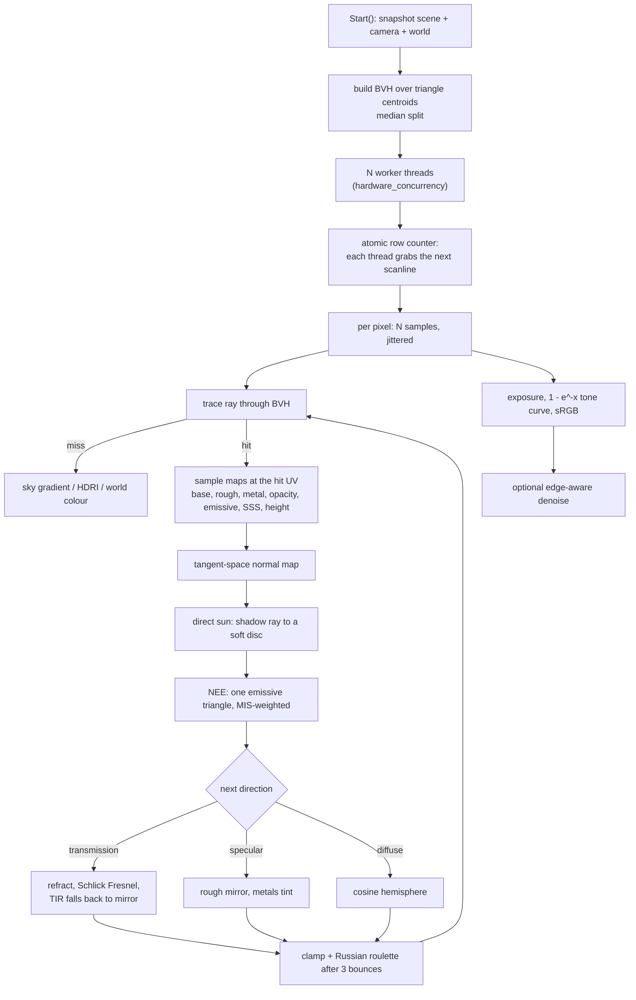

Notes:

- **Acceleration.** This is a binary BVH with a median split over triangle centroids and slab tests for
  the nodes. That's plenty for editor-scale scenes.
- **Scheduling.** Threads pull scanlines from an atomic counter, so fast and slow rows balance
  on their own. Each row seeds its own RNG from the row index and the user seed, which makes
  renders reproducible.
- **Materials.** It uses the same `Material` as the viewport. Every texture is kept as a CPU
  copy (`TextureData`, bilinear sampling, tiled) alongside the GPU copy, so the tracer can sample
  maps per hit. It supports parallax occlusion from the Height map, opacity cut-through,
  transmission with IOR, a wrapped-diffuse subsurface term, and Blender-style emission
  (colour × strength).
- **Environment.** There are 8 built-in HDRI presets (`render/HdriPresets.*`: Studio Softbox, Noon Sky,
  Golden Hour, Overcast, Night, Interior Window, Warehouse, Forest Clearing). They are generated
  procedurally as equirectangular float images instead of shipping as files. Custom
  `.hdr` files light the scene the same way.
- **Camera.** Perspective uses the scene camera's focal length and sensor width (or the
  viewport view).

| Textured material, procedural sky | Glass and diffuse, soft sun shadows |
|---|---|
|  |  |

### Area lights: next-event estimation with MIS

Emissive surfaces used to light the scene only when a random bounce happened to hit them, so
small area lights were dim and noisy. The tracer now does **next-event estimation (NEE)**:

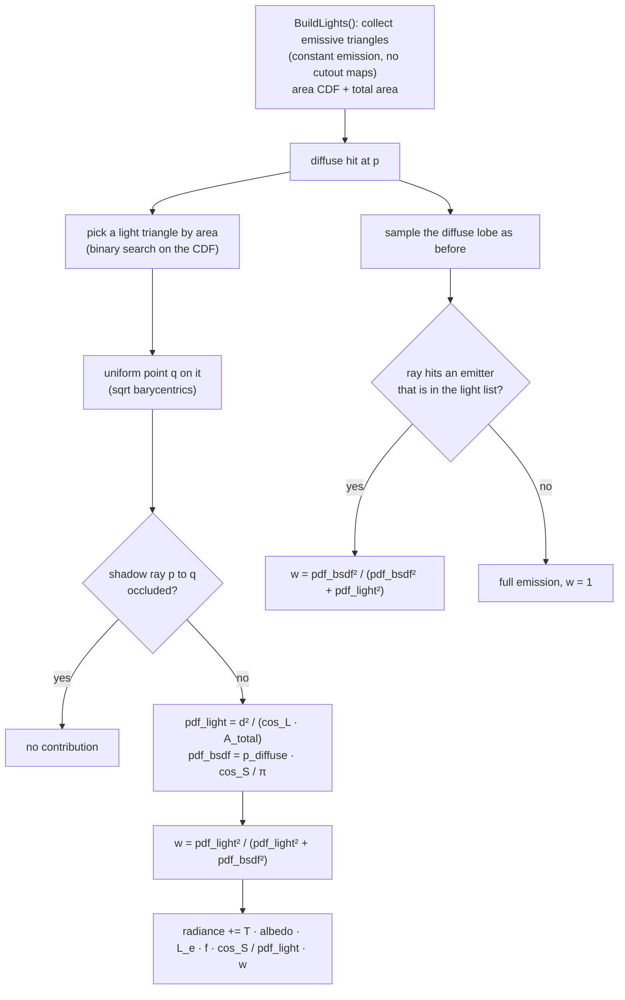

- The two strategies are combined with the **power heuristic**, so neither one double-counts
  the light. MIS applies to the diffuse lobe, the only lobe NEE also samples. Specular,
  transmissive and cut-out paths that reach a light keep full weight.
- Emitters driven by a texture (an Emissive, Opacity or Base Color map) stay BSDF-only. That's
  still unbiased, they just don't get the variance reduction.
- `RayTraceSettings::lightSampling` turns NEE off for comparison.

### Normal maps in renders

Each `RTTri` stores `dP/du` and `dP/dv` from its corner UVs. At a hit, the Normal map is sampled
and the tangent-space normal is rotated into that frame before shading. Normal maps are assumed
to be OpenGL-style (+Y); DirectX maps need their green channel flipped.

### Threading fix

Completion used to be decided by whichever worker noticed the row counter was exhausted, while
other workers could still be writing pixels. Now an atomic count of live workers decides it:
only the **last worker to exit** marks the render finished and runs the denoiser.

### Current limits

These are tracked in [PARITY.md](../PARITY.md). Rendering runs on the CPU (Vulkan RT is
detected but not used yet). Specular and transmission lobes aren't light-sampled. Volumetrics,
caustic-specific sampling and light portals aren't implemented.

---

## 10. Texture painting

The 2D side is a layered PBR texture painter.

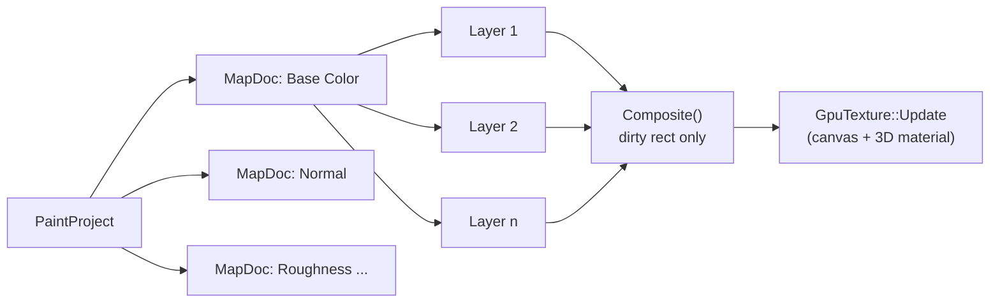

- **11 map kinds**: Base Color, Normal, Roughness, Metallic, AO, Cavity, Height, Emissive,
  Opacity, ORM and Custom. Each has its own default fill and list colour.
- **Layer stacks per map** with visibility, lock, opacity, rename, reorder, and duplicate.
- **16 blend modes**: Normal, Multiply, Screen, Overlay, Darken, Lighten, Color Dodge, Color
  Burn, Hard Light, Soft Light, Difference, Exclusion, and the four non-separable HSL modes
  (Hue, Saturation, Color, Luminosity) implemented with the standard `Lum`/`SetLum`/`SetSat`
  formulation.
- **Normal maps don't alpha-blend.** Layers on a Normal map are combined with **Reoriented
  Normal Mapping**: the detail normal is rotated into the base normal's frame, so stacked
  detail keeps its strength instead of flattening.
- **Brushes**: brush, pencil, eraser and fill, with size, opacity, hardness (a flat core with a
  smooth falloff), flow and spacing. A stroke is a spaced line of dabs, and the leftover
  distance carries between segments, so the spacing stays even across mouse events.
- **Dirty-region compositing.** Each dab grows a `DirtyRect`. `Composite()` re-blends only that
  rectangle, and only then is the texture re-uploaded to the GPU. A painted Base Color map can be
  applied straight to the 3D material.

---

## 11. The .leorix project container

A `.leorix` file is a **ZIP** (written with miniz) that contains:

```
project.leorix
├── manifest.json            canvas, project settings, brush, full layer hierarchy, 3D scene
├── blocks.json              the visual scripting graph, when one was started
├── layers/
│   ├── L1_albedo.png        one PNG per layer, named L{id}_{mapKind}.png
│   ├── L2_albedo.png
│   └── L3_roughness.png
└── objects/
    ├── O1.bin               object 1's mesh arrays, skin weights and multires detail
    └── O1_map2.png          object 1's material texture in slot 2 (Roughness)
```

The layer PNGs are stored with `MZ_BEST_SPEED`, because PNG data is already compressed and deflate has little left
to gain. Here is the manifest from `samples/rt.leorix` (abridged):

```json
{
  "format": "leorix",
  "version": "1.0",
  "generator": "Leorix Native",
  "canvas":  { "width": 256, "height": 256, "colorSpace": "sRGB", "bitDepth": 8 },
  "project": { "name": "roundtrip", "activeMap": 0 },
  "brush":   { "size": 40.0, "opacity": 80.0, "hardness": 50.0, "flow": 100.0, "spacing": 0.12 },
  "maps": [
    {
      "name": "Base Color", "kind": "albedo", "activeLayer": 1,
      "layers": [
        { "id": 1, "name": "Background", "blend": "normal",   "opacity": 100.0,
          "visible": true, "locked": false, "file": "layers/L1_albedo.png" },
        { "id": 2, "name": "Detail",     "blend": "multiply", "opacity": 62.5,
          "visible": true, "locked": false, "file": "layers/L2_albedo.png" }
      ]
    },
    {
      "name": "Roughness", "kind": "roughness", "activeLayer": 0,
      "layers": [
        { "id": 3, "name": "Background", "blend": "normal", "opacity": 100.0,
          "visible": true, "locked": false, "file": "layers/L3_roughness.png" }
      ]
    }
  ]
}
```

Loading is **tolerant**: every field is read with a default, and unknown fields are ignored, so
files from newer versions still open. Indices such as `activeLayer` are clamped, and a map with no layers
gets a background layer filled with that map's default colour. Blend modes and map kinds are
stored as stable string ids (`"color-dodge"`, `"roughness"`), not enum numbers.

### The 3D scene

The manifest's `"scene"` section holds every object with its name, visibility, shading,
transform, material settings, modifier stack, curve, multires level, armature (bones, rest and
pose, constraints) and keyframe action. It also holds the cameras, the active object and camera,
and the playback rate and frame. The heavy arrays live in one little-endian binary file per
object, `objects/O{n}.bin`. It starts with the magic `LXOB` and version 1, then holds positions,
normals, per-vertex UVs, face-corner UVs, triangles, the polygon count, seam and sharp edge keys,
the armature's bind positions and weights, and the multires displacement. Each array is a `uint32`
count followed by the raw elements. Material textures are stored as PNGs next to the binary file.

A project without a `"scene"` section (saved before the scene was stored) opens without touching
the scene that is already open. Loading treats the file as untrusted:

- Every number is type-checked, range-clamped and NaN-checked.
- Array counts are checked against the bytes left in the binary file.
- An object whose triangle points past its vertex list is skipped with a note.
- Bone parents must come before their children.
- Constraint, weight and keyframe bone indices that point nowhere are dropped.
- Modifier settings are capped, so a damaged file can't ask for a billion array copies.

---

## 12. Undo and redo

`core/Undo.*` is deliberately small. An `UndoEntry` is a label, two closures (`undo` and
`redo`) and the number of bytes it holds:

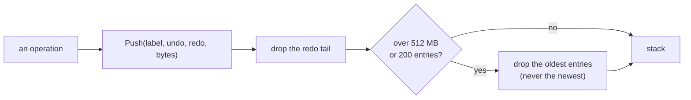

Because the closures capture exactly what an operation needs, each subsystem picks its own
representation:

- **Paint strokes** store only the **128×128 tiles a stroke touched**, before and after
  (`StrokeUndo`). Copying a whole 2048² RGBA layer for every stroke would cost 16 MB, while a
  typical stroke touches a handful of tiles.
- **Layer structure** changes (add, duplicate, delete, reorder) snapshot the whole stack.
- **3D operations** (move/rotate/scale, add primitive, delete object) capture transforms or
  objects.
- **Topology edits** (Extrude, Delete, Merge) snapshot the whole `Mesh` before and after,
  because vertex and triangle counts change.
- **Sculpt strokes** store the vertex positions (or multires displacement) before and after,
  one step per stroke.
- **Material parameters** use `CopyMaterialParams`, which copies every scalar but no GPU handles
  or textures. Sliders record **one step per drag**: the state is captured when the widget
  activates (`IsItemActivated`) and pushed when the drag ends (`IsItemDeactivatedAfterEdit`),
  not every frame.
- **Texture slots** go through `PushMaterialTextureUndo`, which runs the change and records only
  the slots it altered. It keeps their CPU pixels and paths, and rebuilds the GPU copy from them
  on undo/redo.
- **Maps, armatures and keyframes**: map delete, structural armature edits (whole-armature snapshot) and pose drags (just the dragged bone),
  insert/delete keyframe, interpolation changes and Bake Animation all go through
  `App::PushObjectUndo<T>`. That's a small template that stores `before`/`after` values of any
  type and an `apply` lambda, addressed by object index so it stays valid as the scene changes.

The Edit menu shows the name of the next undo step, and a History panel lists the whole stack.

---

## 13. UV unwrapping

`mesh/Unwrap.*` implements the classic pipeline: **cut at seams → flatten with LSCM → pack**.

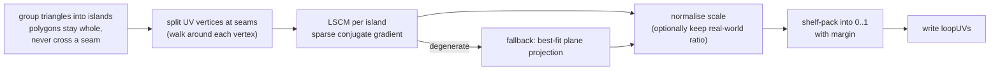

- **Island building.** Triangles of one polygon always stay together, and polygons join across any
  edge that isn't a seam.
- **Seam splitting.** Two corners at the same vertex share a UV vertex only if you can walk
  between their faces around that vertex without crossing a seam. That's what lets a cut tube
  flatten into a rectangle.
- **LSCM** (least squares conformal maps) solves the normal equations with conjugate
  gradient on sparse rows. Two vertices are pinned to remove translation, rotation and scale.
  They're the two ends of a **real mesh edge**, not the two farthest vertices: pinning a chord
  fights the conformal solution on curved surfaces. Triangulation diagonals are skipped when
  choosing the pin edge, otherwise every quad island would land at 45° and waste space in the pack.
- Flat and developable surfaces unwrap with **0° angle distortion**.

The UV editor overlays the layout on the 2D canvas. It detects seams as edges whose two sides
land apart in UV space, or edges with only one face, and it can bake the UV layout or the seams
into a new paint layer.

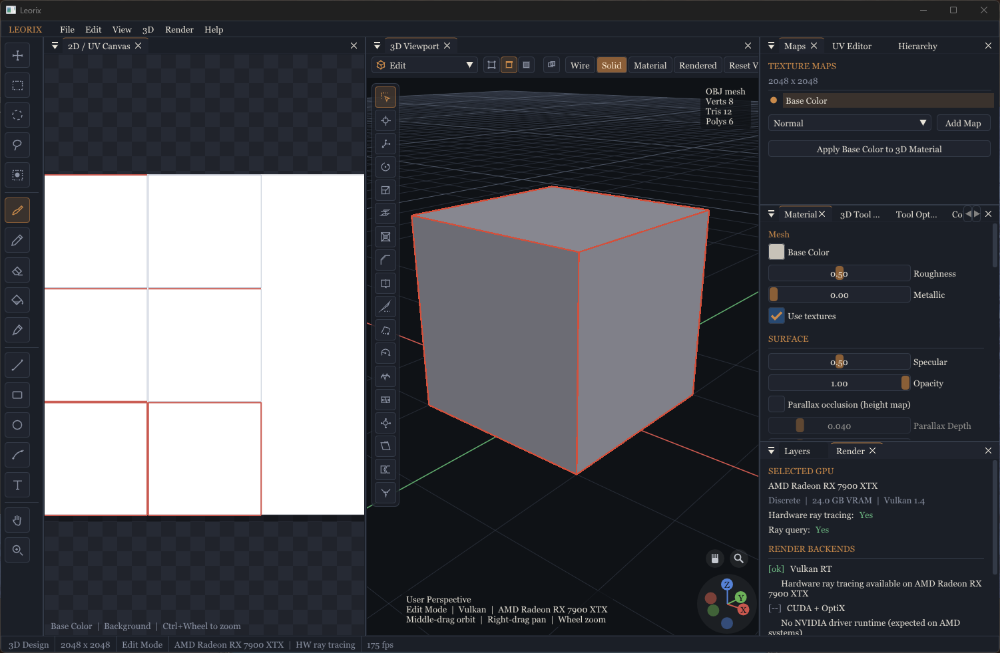

### Smart UV Project

`SmartUVProject` needs no seams. It flood-fills polygons across shared edges while each one's
normal stays within the angle limit (66° by default) of the group's first polygon. The borders
between groups become temporary seams, the normal Unwrap pipeline runs, and then the user's own
seams are put back. A cube gives six islands.

### Editing UVs on the canvas

`mesh/UVEdit.*` holds the math, so the self-test can check it without a window:

- **Islands.** `UVIslands` joins two triangles when they share a mesh edge with the same UVs on both sides.
- **Picking.** `PickUVTriangle` finds the triangle under a UV point and `PickUVCorner` the nearest corner.
- **Selection.** One flag per face corner, filled by `SelectUVIsland` or `SelectUVVertex`.
- **Move, rotate, scale.** `TransformUVSelection` always writes from the UVs saved when the
  gesture began, so a long drag never builds up rounding error. One undo step per gesture.

With **Edit UVs on the canvas** switched on, a click selects an island or a vertex (Shift adds or
toggles) and dragging moves it. The UV Editor panel has Rotate and Scale drags. The canvas brush
is off while this is on.

### Painting on the 3D model

In Sculpt Mode the **Paint** brush paints texture instead of moving vertices:

1. The viewport pick already gives the hit triangle and the world point. That point is moved
   into object space.
2. `SurfaceUV` turns it into a UV using barycentric weights on the triangle's corner UVs.
3. The UV becomes a map pixel: x = u × width, y = (1 − v) × height.
4. The brush radius, which is measured in screen pixels as for sculpting, is converted to surface
   units and then to map pixels with `TexelsPerUnit`. The dab therefore covers the same area as
   the ring shown in the viewport.
5. The dab goes through the same `PaintStroke` path as the 2D canvas, with the same colour,
   opacity, hardness, Eraser and dirty-tile undo.

When consecutive hits land far apart in UV space, the brush has crossed a seam, so it stamps
instead of drawing a line across the texture. Any material slot still showing that map, which is
labelled "*map* (painted)" when a map is dropped onto it, is refreshed in place about every
150 ms during a stroke and once more when the stroke ends or is undone.

---

## 14. Scripting

Leorix embeds **Lua 5.4** for procedural mesh building. The full API and examples are in
[SCRIPTING.md](SCRIPTING.md). Architecturally:

- Each run creates a fresh `lua_State`, which is closed afterwards. Results (meshes and `print`
  output) are collected into a `ScriptResult`.
- **Sandbox**: only the `base`, `math`, `string` and `table` libraries are opened, and
  `dofile`, `loadfile`, `load`, `require` and `collectgarbage` are removed. Scripts have no file,
  OS or network access.
- Primitive functions call the same `BuildPrimitive` the UI uses, so scripted meshes get the
  same clean, Blender-matching topology. `mesh()` returns a userdata builder with
  `vert` / `face` / `build`. Faces are polygons, so scripted quads stay quads.

---

## 15. Testing and the build

### Build

```powershell
cmake -S . -B build -G Ninja -DCMAKE_BUILD_TYPE=Release
cmake --build build
.\build\leorix.exe
```

- C++20, CMake ≥ 3.24, Ninja, WinLibs MinGW-w64 (UCRT). No Visual Studio, and no Vulkan SDK.
- ImGui, Lua, ufbx, miniz and volk are compiled as small static libraries from their pinned
  sources. SDL3 is built static.
- On MinGW the exe is linked with `-static -static-libgcc -static-libstdc++`, so there are no
  runtime DLLs to ship.

### Tests

`leorix.exe --selftest` is a headless test suite that runs without a GPU or a window. It checks:

- **Primitives**: every vertex and face count against Blender's defaults.
- **Scripting**: the Lua example runs and produces meshes.
- **I/O**: an OBJ export followed by a re-import keeps the cube's quads.
- **Edit operators**: extruding one cube face, deleting a face and merging a face to a point
  give the expected counts, and every index stays in range with `loopUVs` the right size.
- **Tangents**: per-corner tangents are orthogonal to the normal and follow +U, including on
  mirrored UVs.
- **Path tracer**: a multithreaded render is complete when it reports done. NEE matches a
  brute-force reference mean and lowers the noise. A flat normal map is neutral, and a tilted
  one changes the shading.
- **Sculpting**: Draw moves vertices inside the radius and none outside, Smooth reduces
  displacement, and an unsupported brush (Mask) moves nothing.
- **Undo**: copying material parameters keeps the source intact, and material undo/redo
  restores the parameters without touching the texture maps.

It's registered with CTest:

```powershell
cd build
ctest --output-on-failure
```

---

## 16. Contributor notes: extending Leorix

### Adding a primitive

1. Add an entry to `enum class Primitive` in `mesh/Primitives.h`.
2. In `mesh/Primitives.cpp`, add its name to `PrimitiveName`, its defaults to `DefaultParams`,
   and a `case` in `BuildPrimitive`. Build polygons, not just triangles: set `Tri::poly` and
   increment `polyCount`, so quads stay quads.
3. Add it to the Add Mesh list in `app/App3D.cpp` (the `{Primitive::..., "Name"}` table).
4. Optionally expose it to Lua in `tools/Script.cpp` (an `l_xxx` function plus an entry in the
   `globals` table).
5. Add the expected counts to the `SelfTest()` table in `main.cpp`.

### Adding an import or export format

1. Write `static bool ImportXXX(const std::string&, Mesh&, std::string& error)` in
   `mesh/IO.cpp`. Fill `positions`, `tris` (with `poly` ids), `polyCount` and, if the format
   has UVs, `loopUVs` (three per triangle). Finish with `out.HarmonizeNormals()`.
2. Add the extension to `ImportMesh` / `ExportMesh` and to `ImportFilterSpec` /
   `ExportFilterSpec`, so the file dialog offers it.
3. Test it headlessly with `leorix.exe --convert in.xxx out.obj` and add a round-trip check to
   `SelfTest()`.

### Adding a modifier

1. Add a value before `Count` in `enum class ModifierType` (`mesh/Modifier.h`), plus any
   parameters it needs on `struct Modifier`.
2. In `mesh/Modifier.cpp`, add a name and hint to `ModifierName` / `ModifierHint`, implement
   `static Mesh DoXXX(const Mesh& in, const Modifier& m)`, and dispatch to it from
   `ApplyModifier`.
3. Add its parameter widgets to the modifier panel's `switch` in `app/App3D.cpp`. The *Add
   Modifier* combo picks up the new type automatically from `ModifierName`.
4. A modifier returns a **new** mesh. It must never mutate its input, and if it changes the vertex or
   triangle count, it must rebuild `loopUVs` alongside them (see [§5](#5-the-mesh-data-model)).

### House rules

- Match Blender's behaviour and defaults wherever an equivalent exists.
- Keep data in the form the next stage consumes. Don't add conversion layers.
- New logic gets a check in `--selftest`.

---

<sub>Leorix is designed and built by Charlize Pauli.</sub>
