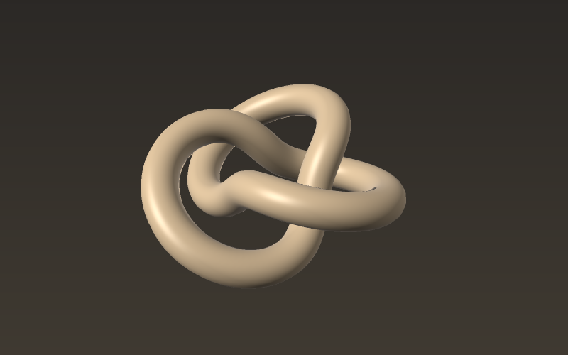
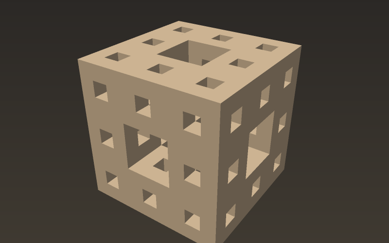
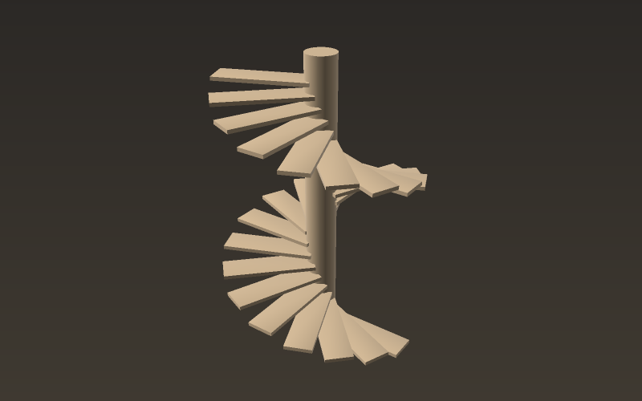
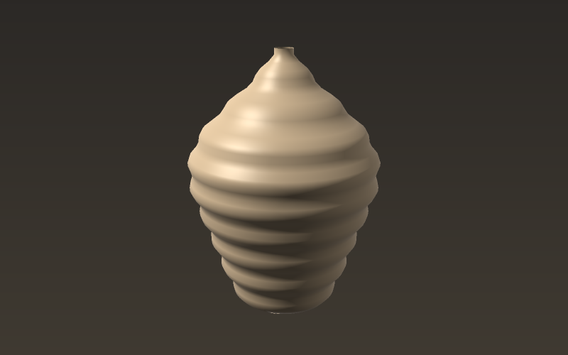
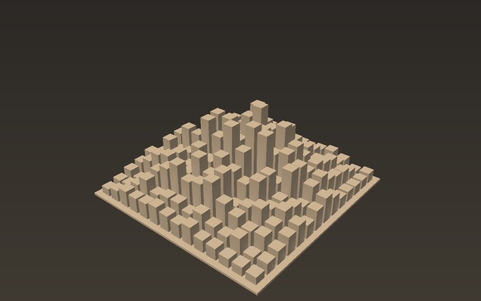
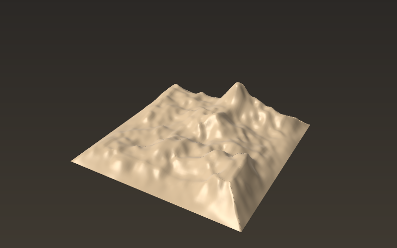

# Leorix Scripting

Leorix can build meshes from code. Scripts are written in **Lua 5.4** and run inside a
sandbox in the app, so a few lines of maths can produce a staircase, a vase, a knot or a
whole landscape.

<p align="center">
  
  
</p>

**Contents**

1. [Getting started](#1-getting-started)
2. [How a script becomes a mesh](#2-how-a-script-becomes-a-mesh)
3. [API reference](#3-api-reference)
4. [The sandbox](#4-the-sandbox)
5. [Building meshes by hand](#5-building-meshes-by-hand)
6. [Procedural techniques](#6-procedural-techniques)
7. [Worked examples](#7-worked-examples)
8. [Performance](#8-performance)
9. [Errors and debugging](#9-errors-and-debugging)
10. [Limitations](#10-limitations)

---

## 1. Getting started

Open the panel from **View → Leorix Scripting** or **3D → Leorix Scripting**.

The panel has four parts:

| Part | What it does |
|---|---|
| **Code editor** | A multi-line editor. Tab inserts a tab. It holds up to 64 KB of text. |
| **Run (Ctrl+Enter)** | Runs the script. Ctrl+Enter works while the panel has focus. |
| **Reset Example** | Puts the built-in example (an ico sphere and a hand-built pyramid) back in the editor. |
| **Output** | Shows everything the script printed, then either a summary of what it created or the error. |

Your first script:

```lua
local verts, tris = ico_sphere(1.0, 3)
print("ico sphere:", verts, "verts", tris, "tris")
```

Press **Run**. The viewport opens with a new object called **Script mesh**, and the output
pane shows:

```
ico sphere:	162	verts	320	tris

Created 1 mesh(es): 162 verts, 320 tris.
```

## 2. How a script becomes a mesh

Every run follows the same steps:

1. A **fresh Lua state** is created. Nothing carries over between runs: globals, tables and
   functions from the last run are gone.
2. The script runs from top to bottom on the UI thread.
3. Every primitive call (`cube()`, `sphere()`, ...) and every `m:build()` adds one mesh to
   the run's result list.
4. If the script **succeeds** and created at least one mesh, all of those meshes are
   **merged into a single new object** named `Script mesh` (or `Script mesh.001`, ... if
   the name is taken). Each run **adds** an object: objects from earlier runs stay in the
   scene until you delete them from the Hierarchy panel. The new object is selected and the
   3D viewport is shown.
5. When it enters the scene, the mesh goes through the same clean-up as an imported model:
   - **Winding is fixed automatically.** Faces are made consistent across each connected
     piece, and each closed piece is turned outward by its signed volume. A face wound the
     wrong way won't show up inside-out, but it's still good practice to wind correctly
     (see [section 5](#5-building-meshes-by-hand)).
   - **UVs are kept per mesh.** Each mesh in the merge keeps the UVs it came with (for
     example `plane()`'s 0–1 square). A mesh with no UVs, which includes everything built
     with `mesh()`, gets its own spherical projection so Material Preview has something to
     sample. The fallback never overwrites another mesh's UVs.
6. If the script **fails**, nothing is added to the scene, even meshes that were created
   before the error. The error appears in the output pane.

### Coordinate system

Leorix stores geometry **Y-up**. In script coordinates:

- **+Y is up.** The ground plane is X/Z.
- Blender's axes map as follows: Blender Z is Leorix +Y, and Blender Y is Leorix −Z.
- Units are metres, and the default primitives match Blender's sizes (a 2 m cube, a 1 m
  radius sphere).

---

## 3. API reference

### 3.1 Primitives

All primitives are created **at the origin, centred on their own bounding box**, using the
same topology as Blender's *Add Mesh* menu (quads stay quads, and caps are n-gons). They
can't be moved or rotated from a script, so if you need copies in different places, build
them by hand (see [section 6.2](#62-instancing-and-arrays)).

Every primitive returns **two integers: the vertex count and the triangle count** of the
mesh it created.

| Function | Parameters (default) | Notes |
|---|---|---|
| `cube(size)` | `size` = 2.0 | Edge length. 8 verts, 6 quads. |
| `plane(size)` | `size` = 2.0 | One quad in the X/Z plane. |
| `circle(radius, verts)` | `radius` = 1.0, `verts` = 32 | One filled n-gon. `verts` ≥ 3. |
| `grid(x, y, size)` | `x` = 10, `y` = 10, `size` = 2.0 | `x` and `y` are the **number of quads** along each side, so `grid(10,10)` gives 121 verts and 100 quads. Minimum 1. |
| `sphere(radius, segments, rings)` | 1.0, 32, 16 | UV sphere. `segments` ≥ 3, `rings` ≥ 2. Default: 482 verts, 512 faces. |
| `ico_sphere(radius, subdivisions)` | 1.0, 2 | `subdivisions` is clamped to 1–6. Default: 42 verts, 80 tris. |
| `cylinder(radius, depth, verts)` | 1.0, 2.0, 32 | `depth` is the height along Y. N-gon caps. `verts` ≥ 3. |
| `cone(radius, depth, verts)` | 1.0, 2.0, 32 | N-gon base, apex on +Y. `verts` ≥ 3. |
| `torus(major, minor, majseg, minseg)` | 1.0, 0.25, 48, 12 | `major` is the ring radius and `minor` the tube radius. Both segment counts ≥ 3. |

All parameters are optional, and trailing ones can be left out:

```lua
cube()                 -- 2 m cube
sphere(0.5)            -- 0.5 m sphere with 32 x 16 segments
torus(1.2, 0.3, 64)    -- 64 major segments, default 12 minor
```

Counts must be **whole numbers**. `sphere(1, 12.5)` fails with
`bad argument #2 to 'sphere' (number has no integer representation)`.
Sizes accept any number, and passing anything that isn't a number (for example a string) is
an error.

### 3.2 Manual meshes

| Call | Returns | Description |
|---|---|---|
| `m = mesh()` | a mesh object | Starts a new, empty mesh. Nothing appears in the scene until you call `m:build()`. |
| `m:vert(x, y, z)` | integer index | Adds a vertex and returns its **0-based** index. All three numbers are required. |
| `m:face(a, b, c, ...)` | nothing | Adds one polygon from 3 or more vertex indices, in winding order. Quads and n-gons are kept as single faces. |
| `m:build()` | nothing | Snapshots the mesh into the run's results: it computes normals and bounds and names it `Script mesh`. |

Details that matter:

- **Indices are 0-based**, unlike most Lua conventions. Always use the value `vert()`
  returned rather than counting by hand.
- **Every index is checked.** An index that `vert()` never returned on *this* mesh stops
  the script with, for example,
  `face(): vertex index 3 does not exist (this mesh has 3 vertices, numbered 0 to 2)`.
  Indices from a different `mesh()` don't count: each mesh numbers its vertices from 0.
- `face()` with fewer than 3 indices raises `face() needs at least 3 vertices`. Repeating
  an index is allowed as long as at least 3 **different** vertices remain. Otherwise it
  raises `face() needs at least 3 different vertices`.
- `build()` on a mesh with no vertices or faces raises `mesh has no geometry to build`.
- `build()` can be called **more than once**. Each call adds a separate copy of the mesh as
  it is at that moment, and you can keep adding to `m` afterwards. To avoid accidental
  duplicates, call it once at the end.

### 3.3 Helpers

| Name | Description |
|---|---|
| `print(...)` | Writes to the Output pane, not the console. Arguments are separated by tabs and the line ends with a newline. Any value that can be turned into a string is accepted. |
| `PI` | π, the same as `math.pi`. |
| `frame` | The timeline's current frame. The first frame is 1. |
| `fps` | Frames per second of the timeline (24 by default). |
| `time` | Seconds since frame 1: `(frame - 1) / fps`. |
| `math.*`, `string.*`, `table.*` | The standard Lua 5.4 libraries. See [the sandbox](#4-the-sandbox). |

There is no vector type: pass plain numbers, and write small table helpers when you need
vector maths (the torus knot example has `sub`, `cross` and `norm`).

### 3.4 Animating with `frame` and `time`

A script runs once and returns a mesh, so to animate it, run it again on every frame. Tick
**Update every frame** next to **Run**, run the script once, then press **Play** on the
timeline. Each time the frame changes the script runs again with the new `frame` and `time`,
and its result replaces the mesh the last run made. These re-runs don't add undo steps.

```lua
-- A wave that rolls across a grid of cubes
for x = 0, 9 do
  for z = 0, 9 do
    local h = 1 + 0.5 * math.sin(time * 3 + x * 0.6 + z * 0.4)
    local m = mesh()
    local s = 0.4
    local v = {}
    for _, c in ipairs({{-s,0,-s},{s,0,-s},{s,0,s},{-s,0,s},{-s,h,-s},{s,h,-s},{s,h,s},{-s,h,s}}) do
      v[#v + 1] = m:vert(x + c[1], c[2], z + c[3])
    end
    m:face(v[1], v[2], v[3], v[4]); m:face(v[8], v[7], v[6], v[5])
    m:face(v[1], v[5], v[6], v[2]); m:face(v[2], v[6], v[7], v[3])
    m:face(v[3], v[7], v[8], v[4]); m:face(v[4], v[8], v[5], v[1])
    m:build()
  end
end
```

Keep animated scripts small: the script runs on every frame, and a slow one makes playback
stutter.

### 3.5 Scene scripts: materials, curves, camera and light

A script can also describe how its scene looks. These calls are used when the script is rendered
headless; the **Scripting** panel builds the geometry only.

```text
material{color={r,g,b}, roughness=, metallic=, emission={r,g,b}, strength=, glass=ior, smooth=true,
         sample_light=false}
curve({{x,y,z}, ...}, {radius=, sides=, cyclic=, nurbs=, taper={...}, resolution=})
camera{eye={x,y,z}, target={x,y,z}, lens=mm, fstop=, focus=}
world{preset="Dusk", strength=, rotation=deg, sun_elevation=, sun_azimuth=, sun_strength=,
      sun_color={r,g,b}, sky_color={r,g,b}, horizon_color={r,g,b}, sky_strength=, exposure=}
```

- `material{}` applies to every mesh made after it, until the next `material{}`. Fields you leave
  out go back to the defaults. `glass=1.5` makes a clear glass with that index of refraction;
  `emission` and `strength` make the mesh a light. `sample_light=false` keeps the glow but stops the
  tracer aiming shadow rays at it, which is right for big, dim emitters such as clouds or a glowing
  waterfall: they would otherwise take light samples away from small bright lamps.
- `curve()` sweeps a round tube along a smooth curve through the points, using the same curve code
  as curve objects. `taper` gives a radius scale per point.
- `world{}` presets are `StudioSoftbox`, `NoonSky`, `GoldenHour`, `Overcast`, `Night`,
  `InteriorWindow`, `Warehouse`, `ForestClearing` and `Dusk`. A preset's sunset or sun sits on +X;
  turn it with `rotation`. Without a preset, the sky is a gradient from
  `horizon_color` to `sky_color`.

Render a scene script without opening the app:

```sh
leorix.exe --headless-render scene.lua out.png --width 1920 --height 1080 --spp 512 --denoise 1
```

The [showcase scene](showcase/lantern_isle.lua) behind the README image uses all of these.

---

## 4. The sandbox

Scripts can't touch your files, the OS or the network. This is exactly what's available:

| Library | Status |
|---|---|
| base | ✅ loaded, **except** `dofile`, `loadfile`, `load`, `require` and `collectgarbage`, which are removed |
| `math` | ✅ |
| `string` | ✅ (`string.dump` exists but does nothing useful, because `load` is gone) |
| `table` | ✅ |
| `io`, `os`, `package` | ❌ not loaded |
| `coroutine`, `utf8`, `debug` | ❌ not loaded |

What this means in practice:

- There's no `os.clock()` for timing and no `os.time()` for seeding. Use a fixed seed
  constant and your own hash (see the terrain example).
- A script can't load another file, so every script must be self-contained. Copy helpers
  such as `box()` into each script.
- `pcall`, `error`, `assert`, `setmetatable`, `ipairs`/`pairs`, `select`, `tostring` and the
  Lua 5.4 integer and bitwise operators (`//`, `&`, `|`, `~`, `<<`, `>>`) all work.

### Limits

Scripts run on the UI thread, so Leorix stops any script that would otherwise freeze or
exhaust the app:

| Limit | Value | Error shown |
|---|---|---|
| Instructions | about **100 million** Lua instructions per run | `script took too long (stopped after 100 million instructions)` |
| Memory | **512 MB** of Lua memory (tables, strings, closures) | `script ran out of memory (limit 512 MB)` |

- An endless `while true do end` is stopped after about 0.3 s on a typical desktop CPU.
- Wrapping the loop in `pcall` doesn't help: the limit fires again within a million
  instructions, so the script still ends.
- Both limits count **per run** and reset on the next Run.
- Every example in this guide uses only a small fraction of either budget. A level-3 Menger
  sponge (64,000 verts) runs comfortably within them.
- The memory cap covers Lua's own memory. Vertex and face data already passed to
  `vert()`/`face()` lives in Leorix's mesh buffers; the instruction limit is what bounds
  how much of that one run can produce.

---

## 5. Building meshes by hand

### 5.1 Faces, winding and normals

A face's front side is the side from which its vertices appear **counter-clockwise**. That's
the side its normal points to (the right-hand rule).

```lua
-- A quad lying on the ground, facing up (+Y)
local m = mesh()
local a = m:vert(-1, 0, -1)
local b = m:vert(-1, 0,  1)
local c = m:vert( 1, 0,  1)
local d = m:vert( 1, 0, -1)
m:face(a, b, c, d)       -- seen from above this is counter-clockwise, so the normal is +Y
m:build()
```

Leorix harmonizes winding when the mesh enters the scene (see section 2), so mistakes get
repaired. Still, wind correctly:

- On **open** surfaces such as terrain or a single sheet, "outward" is ambiguous. The fix
  makes every face agree with its neighbours, but it can't know which side you meant as the
  top.
- Your intent stays in the script, so it doesn't rely on a repair step.

A quick way to check: work out `cross(b - a, c - a)` for the first three corners. It should
point away from the solid.

### 5.2 Quads and n-gons

`face()` takes any number of indices, so you can write the topology you mean:

```lua
m:face(a, b, c)            -- triangle
m:face(a, b, c, d)         -- quad, stays one face in Edit Mode
m:face(table.unpack(ring)) -- n-gon from a Lua array of indices
```

Internally, every polygon is split into a **fan of triangles from its first vertex**, and
each triangle keeps the polygon's id. The Edit Mode wireframe then shows your quad or n-gon
edges and never the hidden diagonals.

A fan is only correct when every triangle `(v1, vi, vi+1)` lies inside the polygon:

- **Convex** polygons (caps, quads, regular n-gons) always work.
- **Concave** polygons work only if you pick a first vertex that can "see" every other
  vertex. Otherwise the fan crosses outside the shape. If you're unsure, split concave
  shapes into convex pieces.
- Keep every polygon's vertices **in one plane**. A non-planar quad shades with a visible
  crease along its hidden diagonal.

### 5.3 Shared vertices vs. hard edges

Vertex normals are averaged across all faces that share a vertex. That gives you:

- **Shared vertices** for smooth surfaces such as a vase wall, a tube or terrain. Reuse the
  index.
- **Separate vertices** where a crisp edge is wanted. The `box()` helper in the examples
  doesn't share corners between boxes, so every box stays a separate shell.

The object can also be switched with **3D → Shade Smooth / Shade Flat** after the script
has run.

### 5.4 UVs

Scripts **can't** set UVs yet. A hand-built mesh gets an automatic spherical projection of
its own, while primitives merged into the same object keep their UVs. For real texturing, mark seams in Edit Mode and use **Unwrap (U)**. The LSCM
unwrapper works on script meshes like any other mesh.

### 5.5 A reusable box

Most of the examples share this helper. It emits one closed box with outward-facing quads:

```lua
local function box(m, x0, y0, z0, x1, y1, z1)
  local v = {}
  for i = 0, 7 do                         -- bit 0 = x, bit 1 = y, bit 2 = z
    v[i] = m:vert((i & 1 == 0) and x0 or x1,
                  (i & 2 == 0) and y0 or y1,
                  (i & 4 == 0) and z0 or z1)
  end
  m:face(v[0], v[4], v[6], v[2])  -- -X
  m:face(v[1], v[3], v[7], v[5])  -- +X
  m:face(v[0], v[1], v[5], v[4])  -- -Y
  m:face(v[2], v[6], v[7], v[3])  -- +Y
  m:face(v[0], v[2], v[3], v[1])  -- -Z
  m:face(v[4], v[5], v[7], v[6])  -- +Z
end
```

---

## 6. Procedural techniques

### 6.1 Parametric surfaces

Any surface `P(u, v)` becomes a mesh by sampling it on a grid of `(u, v)` values and joining
neighbouring samples with quads. Keep the indices in a 2D table:

```lua
local idx = {}
for j = 0, V do
  idx[j] = {}
  for i = 0, U do
    idx[j][i] = m:vert(P(i / U, j / V))
  end
end
for j = 0, V - 1 do
  for i = 0, U - 1 do
    m:face(idx[j][i], idx[j + 1][i], idx[j + 1][i + 1], idx[j][i + 1])
  end
end
```

If the surface wraps around (a vase wall, a tube), use `(i + 1) % U` for the next column and
create only `U` columns, so the seam vertices are shared rather than duplicated. The vase
and torus-knot examples both do this.

**Surfaces of revolution** (the vase example) sweep a profile `r(t)` around Y.
**Sweeps** (the torus knot example) move a cross-section along a curve using a frame built
from the curve's tangent: `normal = normalize(cross(tangent, up))` and
`binormal = cross(normal, tangent)`. That frame flips if the tangent ever points straight
along `up`, so pick an `up` the curve never lines up with.

### 6.2 Instancing and arrays

Primitives always land at the origin, so arrays are built by calling a geometry helper with
an offset:

```lua
for gx = 0, N - 1 do
  for gz = 0, N - 1 do
    box(m, gx, 0, gz, gx + 0.8, height(gx, gz), gz + 0.8)
  end
end
```

Rotate instances by applying the rotation to each vertex as it's emitted. The staircase
example rotates each tread about Y with `x*c - z*s, y, x*s + z*c`.

### 6.3 Recursion

Lua functions can call themselves, which makes fractal and L-system-style shapes easy. Each
level subdivides, transforms, or drops some parts:

```lua
local function sponge(x, y, z, s, level)
  if level == 0 then return box(m, x, y, z, x + s, y + s, z + s) end
  local t = s / 3
  for i = 0, 2 do for j = 0, 2 do for k = 0, 2 do
    local centres = (i == 1 and 1 or 0) + (j == 1 and 1 or 0) + (k == 1 and 1 or 0)
    if centres < 2 then sponge(x + i*t, y + j*t, z + k*t, t, level - 1) end
  end end end
end
```

Recursive shapes grow geometrically. The Menger sponge goes up 20× in cube count per level,
so check counts with `print` before raising the depth.

### 6.4 Randomness and noise

There's no `math.noise`. `math.random` is available, but it's seeded differently on every
run, so results change each time. For repeatable results, hash the integer coordinates
yourself:

```lua
local function hash(x, z)
  local h = (x * 374761393 + z * 668265263 + SEED * 2147483647) & 0xffffffff
  h = ((h ~ (h >> 13)) * 1274126177) & 0xffffffff
  return (h ~ (h >> 16)) / 4294967296          -- [0, 1)
end
```

From there, **value noise** is smooth interpolation between the hashed lattice corners, and
**fBm** (fractal Brownian motion) adds several octaves of it at doubling frequency and
halving amplitude. The terrain example has the full code. A quick one-off random value per
cell also works: `(math.sin(x * 12.9898 + z * 78.233) * 43758.5453) % 1`.

---

## 7. Worked examples

Every example lives in [`docs/examples/`](examples/). Paste one into the panel and press
**Run**. Each one has been run through Leorix's script engine, and the counts below are what
it produces.

| Example | Verts | Faces | Triangles | Technique |
|---|---:|---:|---:|---|
| [Spiral staircase](#71-spiral-staircase) | 224 | 162 | 348 | rotated boxes, n-gon caps |
| [Parametric vase](#72-parametric-vase) | 1,968 | 1,921 | 3,886 | surface of revolution |
| [Torus knot](#73-torus-knot) | 3,840 | 3,840 | 7,680 | sweep along a curve |
| [City grid](#74-city-grid) | 1,576 | 1,182 | 2,364 | instanced array |
| [Menger sponge](#75-menger-sponge) | 3,200 | 2,400 | 4,800 | recursion |
| [Terrain](#76-terrain) | 9,409 | 9,216 | 18,432 | height field, fBm noise |

### 7.1 Spiral staircase



A central column built as a 16-sided prism with n-gon caps, plus 24 treads. Each tread is a
box rotated about Y.

```lua
-- docs/examples/staircase.lua
local STEPS  = 24        -- number of treads
local TURN   = 1.5       -- full turns from bottom to top
local RISE   = 0.18      -- height of each step
local INNER  = 0.25      -- column radius
local OUTER  = 1.6       -- outer edge of the treads
local DEPTH  = 0.06      -- tread thickness

local m = mesh()

-- Axis-aligned box from (x0,y0,z0) to (x1,y1,z1), then rotated about Y by `angle`.
local function box(x0, y0, z0, x1, y1, z1, angle)
  local c, s = math.cos(angle or 0), math.sin(angle or 0)
  local v = {}
  for i = 0, 7 do
    local x = (i & 1 == 0) and x0 or x1
    local y = (i & 2 == 0) and y0 or y1
    local z = (i & 4 == 0) and z0 or z1
    v[i] = m:vert(x * c - z * s, y, x * s + z * c)
  end
  -- counter-clockwise when seen from outside, so normals point out
  m:face(v[0], v[4], v[6], v[2])  -- -X
  m:face(v[1], v[3], v[7], v[5])  -- +X
  m:face(v[0], v[1], v[5], v[4])  -- -Y
  m:face(v[2], v[6], v[7], v[3])  -- +Y
  m:face(v[0], v[2], v[3], v[1])  -- -Z
  m:face(v[4], v[5], v[7], v[6])  -- +Z
end

-- the central column as an n-sided prism with n-gon caps
local SIDES, H = 16, STEPS * RISE + 0.4
local bottom, top = {}, {}
for i = 0, SIDES - 1 do
  local a = i / SIDES * 2 * PI
  bottom[i + 1] = m:vert(math.cos(a) * INNER, 0, math.sin(a) * INNER)
  top[i + 1]    = m:vert(math.cos(a) * INNER, H, math.sin(a) * INNER)
end
for i = 1, SIDES do
  local j = i % SIDES + 1
  m:face(bottom[i], top[i], top[j], bottom[j])
end
local cap = {}
for i = SIDES, 1, -1 do cap[#cap + 1] = top[i] end
m:face(table.unpack(cap))       -- top cap, one n-gon
m:face(table.unpack(bottom))    -- bottom cap

-- the treads
for i = 0, STEPS - 1 do
  local y = (i + 1) * RISE
  local angle = i / STEPS * TURN * 2 * PI
  box(INNER * 0.5, y - DEPTH, -0.22, OUTER, y, 0.22, angle)
end

m:build()
print(STEPS, "steps")
```

Notice that the top cap lists the ring **in reverse**. The bottom cap faces down and the
top cap faces up, so the two need opposite winding.

### 7.2 Parametric vase



The profile function `radius(t)` combines a few sine waves. To design your own vase, change
it and press Run again.

```lua
-- docs/examples/vase.lua
local SEGMENTS = 48      -- around
local RINGS    = 40      -- up
local HEIGHT   = 3.0

local function radius(t)            -- t goes 0 (base) .. 1 (lip)
  return 0.55
       + 0.45 * math.sin(t * PI * 1.15)       -- belly
       - 0.25 * math.sin(t * PI * 2.6) * t    -- neck
       + 0.03 * math.sin(t * PI * 18)         -- fine ridges
end

local m = mesh()
local ring = {}
for j = 0, RINGS do
  local t = j / RINGS
  local r = radius(t)
  ring[j] = {}
  for i = 0, SEGMENTS - 1 do
    local a = i / SEGMENTS * 2 * PI
    ring[j][i] = m:vert(math.cos(a) * r, t * HEIGHT, math.sin(a) * r)
  end
end

-- quads between neighbouring rings
for j = 0, RINGS - 1 do
  for i = 0, SEGMENTS - 1 do
    local k = (i + 1) % SEGMENTS
    m:face(ring[j][i], ring[j + 1][i], ring[j + 1][k], ring[j][k])
  end
end

-- closed base as a single n-gon (the lip stays open)
local base = {}
for i = 0, SEGMENTS - 1 do base[#base + 1] = ring[0][i] end
m:face(table.unpack(base))

m:build()
```

### 7.3 Torus knot


A circular cross-section swept along a `(p, q)` torus-knot curve. Try `P, Q = 3, 5` or
`2, 5`. Because the tube wraps both along and around, there are no seams and no caps.

```lua
-- docs/examples/torus_knot.lua
local P, Q       = 2, 3      -- the classic trefoil
local SAMPLES    = 240       -- along the curve
local SIDES      = 16        -- around the tube
local TUBE       = 0.22      -- tube radius

local function knot(t)       -- t in 0 .. 2*PI
  local r = 1 + 0.45 * math.cos(Q * t)
  return r * math.cos(P * t), 0.45 * math.sin(Q * t), r * math.sin(P * t)
end

local function sub(a, b) return {a[1] - b[1], a[2] - b[2], a[3] - b[3]} end
local function cross(a, b)
  return {a[2] * b[3] - a[3] * b[2], a[3] * b[1] - a[1] * b[3], a[1] * b[2] - a[2] * b[1]}
end
local function norm(a)
  local l = math.sqrt(a[1] ^ 2 + a[2] ^ 2 + a[3] ^ 2)
  return {a[1] / l, a[2] / l, a[3] / l}
end

local m = mesh()
local rings = {}
for i = 0, SAMPLES - 1 do
  local t  = i / SAMPLES * 2 * PI
  local dt = 2 * PI / SAMPLES
  local p  = {knot(t)}
  local tangent = norm(sub({knot(t + dt)}, {knot(t - dt)}))
  local normal  = norm(cross(tangent, {0, 1, 0}))
  local binorm  = cross(normal, tangent)
  rings[i] = {}
  for s = 0, SIDES - 1 do
    local a = s / SIDES * 2 * PI
    local c, d = math.cos(a) * TUBE, math.sin(a) * TUBE
    rings[i][s] = m:vert(p[1] + normal[1] * c + binorm[1] * d,
                         p[2] + normal[2] * c + binorm[2] * d,
                         p[3] + normal[3] * c + binorm[3] * d)
  end
end

for i = 0, SAMPLES - 1 do
  local n = (i + 1) % SAMPLES          -- wrap: the tube is closed
  for s = 0, SIDES - 1 do
    local k = (s + 1) % SIDES
    m:face(rings[i][s], rings[n][s], rings[n][k], rings[i][k])
  end
end

m:build()
```

### 7.4 City grid



196 separate boxes in one mesh. Height falls off with distance from the centre and is varied
by a cheap per-cell random value.

```lua
-- docs/examples/city_grid.lua
local N      = 14         -- buildings per side
local PITCH  = 0.5        -- distance between building centres
local WIDTH  = 0.38       -- building footprint

local m = mesh()

local function box(x0, y0, z0, x1, y1, z1)
  local v = {}
  for i = 0, 7 do
    v[i] = m:vert((i & 1 == 0) and x0 or x1,
                  (i & 2 == 0) and y0 or y1,
                  (i & 4 == 0) and z0 or z1)
  end
  m:face(v[0], v[4], v[6], v[2]); m:face(v[1], v[3], v[7], v[5])
  m:face(v[0], v[1], v[5], v[4]); m:face(v[2], v[6], v[7], v[3])
  m:face(v[0], v[2], v[3], v[1]); m:face(v[4], v[5], v[7], v[6])
end

local half = (N - 1) * PITCH / 2
for gx = 0, N - 1 do
  for gz = 0, N - 1 do
    local x, z = gx * PITCH - half, gz * PITCH - half
    local rnd = (math.sin(gx * 12.9898 + gz * 78.233) * 43758.5453) % 1   -- cheap per-cell random
    local h = 0.15 + 3.2 * math.exp(-(x * x + z * z) * 0.12) * (0.35 + 0.65 * rnd)
    local w = WIDTH / 2
    box(x - w, 0, z - w, x + w, h, z + w)
  end
end

-- a thin base slab under the whole block
box(-half - 0.4, -0.08, -half - 0.4, half + 0.4, 0, half + 0.4)

m:build()
print(N * N, "buildings")
```

### 7.5 Menger sponge


Level 2 makes 400 cubes. Level 3 makes 8,000 cubes (64,000 verts) and still runs in about
0.1 s.

```lua
-- docs/examples/menger_sponge.lua
local LEVEL = 2          -- 2 -> 400 cubes; 3 -> 8000 cubes (slow-ish, still fine)
local SIZE  = 2.4

local m = mesh()

local function box(x0, y0, z0, x1, y1, z1)
  local v = {}
  for i = 0, 7 do
    v[i] = m:vert((i & 1 == 0) and x0 or x1,
                  (i & 2 == 0) and y0 or y1,
                  (i & 4 == 0) and z0 or z1)
  end
  m:face(v[0], v[4], v[6], v[2]); m:face(v[1], v[3], v[7], v[5])
  m:face(v[0], v[1], v[5], v[4]); m:face(v[2], v[6], v[7], v[3])
  m:face(v[0], v[2], v[3], v[1]); m:face(v[4], v[5], v[7], v[6])
end

local count = 0
local function sponge(x, y, z, s, level)
  if level == 0 then
    box(x, y, z, x + s, y + s, z + s)
    count = count + 1
    return
  end
  local t = s / 3
  for i = 0, 2 do
    for j = 0, 2 do
      for k = 0, 2 do
        local centres = (i == 1 and 1 or 0) + (j == 1 and 1 or 0) + (k == 1 and 1 or 0)
        if centres < 2 then                       -- keep edges and corners only
          sponge(x + i * t, y + j * t, z + k * t, t, level - 1)
        end
      end
    end
  end
end

sponge(-SIZE / 2, 0, -SIZE / 2, SIZE, LEVEL)
m:build()
print(count, "cubes")
```

The sub-cubes touch but don't share vertices, so internal faces remain. That's fine for
rendering. A single clean shell would need the boxes to share vertices where they touch.

### 7.6 Terrain



A 96 × 96 quad height field made from 4-octave value noise, with the edges faded to zero so
it sits flat on the ground. Change `SEED` for a different landscape.

```lua
-- docs/examples/terrain.lua
local RES     = 96        -- quads per side
local SIZE    = 6.0       -- world size
local HEIGHT  = 1.1
local SEED    = 7

-- deterministic pseudo-random value in [0, 1) for integer lattice point (x, z)
local function hash(x, z)
  local h = (x * 374761393 + z * 668265263 + SEED * 2147483647) & 0xffffffff
  h = ((h ~ (h >> 13)) * 1274126177) & 0xffffffff
  return (h ~ (h >> 16)) / 4294967296
end

local function smooth(t) return t * t * (3 - 2 * t) end

local function noise(x, z)
  local xi, zi = math.floor(x), math.floor(z)
  local xf, zf = smooth(x - xi), smooth(z - zi)
  local a, b = hash(xi, zi),     hash(xi + 1, zi)
  local c, d = hash(xi, zi + 1), hash(xi + 1, zi + 1)
  local top = a + (b - a) * xf
  local bot = c + (d - c) * xf
  return top + (bot - top) * zf
end

local function fbm(x, z)                 -- fractal Brownian motion: 4 octaves
  local sum, amp, freq = 0, 0.5, 1
  for _ = 1, 4 do
    sum = sum + amp * noise(x * freq, z * freq)
    amp, freq = amp * 0.5, freq * 2
  end
  return sum
end

local m = mesh()
local idx = {}
for j = 0, RES do
  idx[j] = {}
  for i = 0, RES do
    local u, v = i / RES, j / RES
    local x, z = (u - 0.5) * SIZE, (v - 0.5) * SIZE
    local h = fbm(u * 3.5, v * 3.5)
    h = h * h * HEIGHT * 2.2                 -- squaring makes valleys flatter, peaks sharper
    local edge = math.min(u, v, 1 - u, 1 - v) -- fade to 0 at the border
    h = h * math.min(1, edge * 8)
    idx[j][i] = m:vert(x, h, z)
  end
end

for j = 0, RES - 1 do
  for i = 0, RES - 1 do
    -- winding chosen so the faces point up (+Y)
    m:face(idx[j][i], idx[j + 1][i], idx[j + 1][i + 1], idx[j][i + 1])
  end
end

m:build()
```

---

## 8. Performance

Scripts are quick. The engine is plain Lua 5.4 and each `vert`/`face` call is a single C
function call. Approximate numbers from running these examples:

| Script | Verts | Time |
|---|---:|---:|
| Terrain (96 × 96) | 9,409 | ~0.04 s |
| Menger sponge level 3 | 64,000 | ~0.1 s |

Tips:

- **Make locals of hot functions** in tight loops: `local sin, cos = math.sin, math.cos`.
  Global lookups cost a table access each time.
- **Compute each vertex once.** On grids, store indices in a table and reuse them for every
  face that touches that vertex. This also gives smooth shading.
- **Call `build()` once.** Each call copies the whole mesh.
- **Watch the growth of recursive scripts.** Every extra level multiplies the counts. The
  whole result is held in memory and then merged and uploaded to the GPU, so a
  multi-million-triangle script makes the viewport, picking and undo snapshots slower too.
- Remember the **instruction budget** (about 100 million per run). A script that hits it
  stops with `script took too long`, so test big loops with small counts first.

---

## 9. Errors and debugging

Errors are shown in the output pane with the line number. The chunk is named `leorix`:

```
Error: [string "leorix"]:2: ')' expected (to close '(' at line 1) near <eof>
Error: [string "leorix"]:2: attempt to index a nil value (local 't')
Error: [string "leorix"]:1: bad argument #1 to 'cube' (number expected, got string)
Error: [string "leorix"]:2: face(): vertex index 3 does not exist (this mesh has 3 vertices, numbered 0 to 2)
Error: [string "leorix"]:2: face() needs at least 3 different vertices
Error: script took too long (stopped after 100 million instructions)
Error: script ran out of memory (limit 512 MB)
```

A script that runs but creates nothing reports:

```
(Script ran, but created no mesh. Call a primitive like cube() or m:build().)
```

Techniques:

- **Print as you go.** `print(#ring, ring[1])` shows table sizes and indices.
  `print(cube())` prints the counts a primitive created.
- **Raise your own errors** with a clear message: `error("radius must be > 0")` or
  `assert(n >= 3, "need at least 3 sides")`.
- **Guard optional parts with `pcall`** to keep the rest of the script running:

  ```lua
  local ok, err = pcall(function() build_details(m) end)
  if not ok then print("details skipped:", err) end
  ```

- **Bad indices are reported where they happen.** If `face()` stops the script with
  `vertex index N does not exist`, the line number points at the face call. The usual causes
  are off-by-one mistakes: forgetting that indices start at 0, wrapping with `% n` on a
  1-based Lua table, or using an index returned by a different `mesh()`.
- **Script stopped with `took too long` or `ran out of memory`?** Look for a loop whose
  exit condition never becomes true, or recursion that grows faster than expected. Print
  the counts at a smaller size first. These two errors have no line number because they
  can happen anywhere in the script.

- **Faces look dark or inside-out?** Leorix fixes winding on closed shells automatically.
  On open sheets, check the cross-product rule in [5.1](#51-faces-winding-and-normals) or
  use **3D → Flip Normals**.

---

## 10. Limitations

Things scripts can't do yet:

- Move, rotate or scale **primitives**. They always appear at the origin, so build
  geometry by hand instead.
- Set **UVs**, vertex colours, materials, seams or sharp edges.
- Create **several objects**. Everything from one run is merged into one object.
- Read or edit **existing** scene objects, the selection, or the camera.
- Load files, other scripts or modules.
- Run in the background. Scripts run on the UI thread, so a long script pauses the app
  until it finishes or hits the [limits](#limits). This also applies to every re-run while
  **Update every frame** is ticked.
- Use `coroutine`, `utf8`, `os` or `io`.
