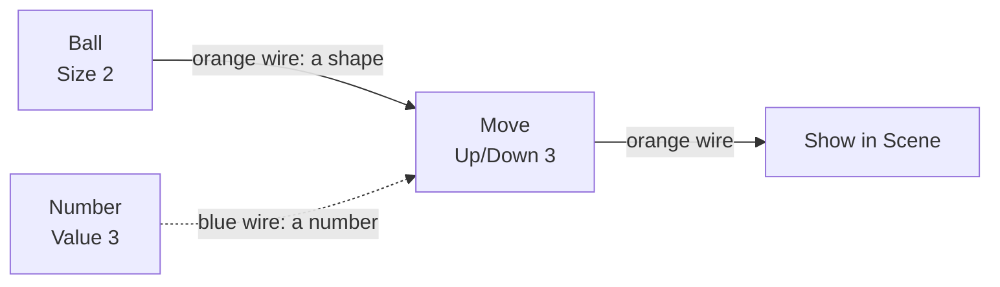
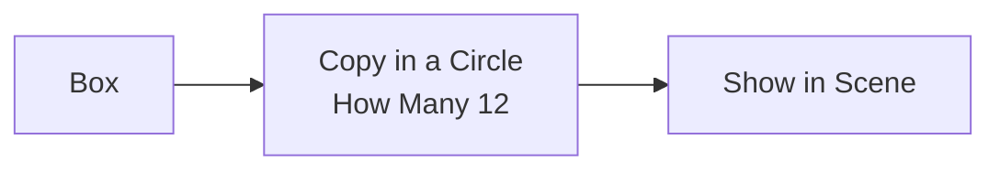
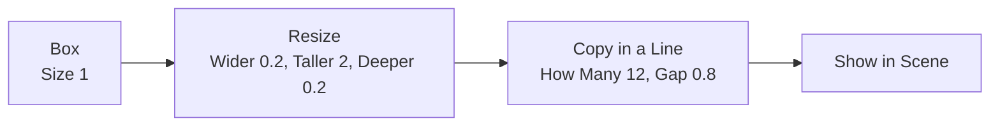
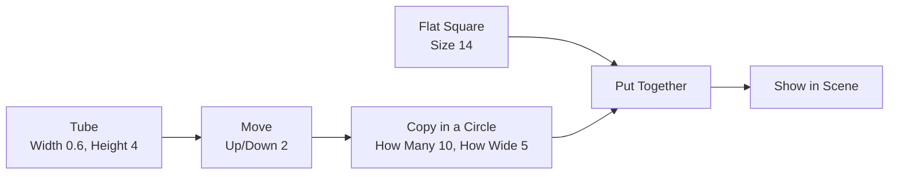
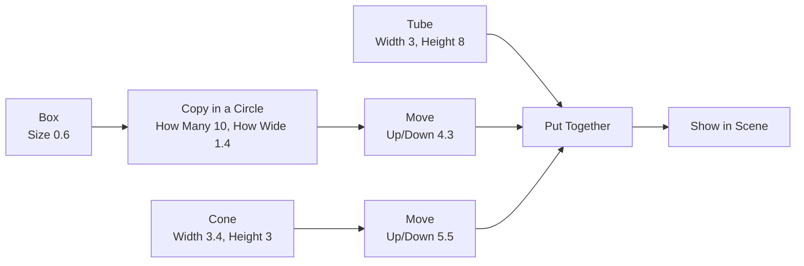

# Visual Scripting: build 3D models with blocks

Visual Scripting lets you make 3D models **without writing any code**. You pick blocks,
connect them with wires, and press **Build it!**. That's all.

Open it from the menu: **View → Visual Scripting (blocks)** (it's also in the **3D** menu).

---

## The two ideas you need

### 1. A block does one small job

A **block** is a box on the screen. Each one does a single thing, like *make a ball*,
*move it up*, or *make 8 copies in a circle*. The coloured bar at the top tells you what
kind of block it is, and the line under the name says what it does.

Hover your mouse over any block, or any number on it, to see help and an example.

### 2. A wire carries something from one block to the next

A **wire** joins two blocks. It always goes from the **dot on the right** of one block
(what comes *out*) to a **dot on the left** of another block (what goes *in*).

There are only two kinds of wire, and you can tell them apart by colour:

| Wire colour | What it carries | Example |
|---|---|---|
| 🟠 **Orange** | a **shape** | a box, a ball, a row of pillars |
| 🔵 **Blue** | a **number** | 3, 0.5, 90 |

An orange wire only plugs into an orange slot, and a blue wire only plugs into a blue slot.
If you try to mix them, Leorix tells you why it won't fit.

If you don't plug anything into a number slot, the block uses the number typed on it.
You can drag that number left or right to change it, or double-click it to type a number.

---

## Your first model in 5 steps

1. **Open the panel.** Go to **View → Visual Scripting (blocks)**. You'll see a starter example:
   a Ball, wired into Copy in a Circle, wired into Show in Scene.
2. **Press Build it!** A ring of 8 balls appears in the 3D view. You just ran your first script.
3. **Change a number.** On the *Copy in a Circle* block, drag **How Many** to 12. Press **Build it!** again.
   Now there are 12 balls. (Each build adds a new model, so press **Ctrl+Z** to remove the old one.)
4. **Swap the shape.** Click **Box** in the *Add a block* list. Drag a wire from the Box's right-hand
   dot onto the **Shape** dot of *Copy in a Circle*. The new wire replaces the old one.
5. **Build it!** You now have a ring of boxes. Right-click the old Ball and pick
   **Remove this block** to tidy up.

---

## Every block

### Shapes: blocks that make something from nothing

| Block | What it does | Example use |
|---|---|---|
| **Box** | Makes a cube. | Size 2 makes a 2-metre box. |
| **Ball** | Makes a smooth ball. | Size 1 makes a small marble. |
| **Tube** | Makes a round tube with flat ends, like a can or a pillar. | Width 0.5, Height 4 makes a thin pillar. |
| **Cone** | Makes a cone: round at the bottom, pointy at the top. | Width 2, Height 3 makes a tree top. |
| **Donut** | Makes a ring with a hole in the middle. | Size 2, Thickness 0.3 makes a thin ring. |
| **Flat Square** | Makes a flat square with no thickness, like a floor tile. | Size 20 makes a big floor. |

### Change: blocks that change a shape you plug in

| Block | What it does | Example use |
|---|---|---|
| **Move** | Slides a shape left/right, up/down or forward/back. | Up/Down 3 lifts it 3 metres. |
| **Turn** | Spins, tips or rolls a shape. Numbers are degrees (90 = a quarter turn). | Tip 90 lays a standing tube on its side. |
| **Resize** | Makes a shape bigger or smaller. 1 means no change, 2 means twice as big. | Taller 3 stretches a box into a tall block. |
| **Mirror** | Keeps your shape and adds a flipped copy on the other side, like a reflection. Pick **Flip**: left / right, up / down or front / back. | A Ball moved 2 to the right, then mirrored, makes a pair of eyes. |

### Repeat: blocks that make copies

| Block | What it does | Example use |
|---|---|---|
| **Copy in a Line** | Makes copies side by side in a straight row. | 10 copies with Gap 1 makes a fence. |
| **Copy in a Circle** | Places copies evenly around a circle, all facing outward. | 8 pillars, How Wide 5, makes a stone circle. |
| **Copy in a Grid** | Makes rows and columns of copies, like a chessboard. | 3 rows × 4 columns makes 12 copies. |
| **Copy Upwards** | Stacks copies one above the other. | 10 flat boxes with Gap 1 makes a tower. |
| **Scatter Randomly** | Drops copies at random spots inside a square (Area) and spins each one. The same Seed gives the same layout. | 50 cones in an Area of 40 makes a forest. |

You can make up to **1000 copies** in one block. If you ask for more, Leorix uses 1000 and
shows a note, so your computer doesn't freeze.

### Mix

| Block | What it does | Example use |
|---|---|---|
| **Put Together** | Joins up to four shapes into one model. | A Tube trunk + a Ball moved up = a tree. |

### Numbers: blocks that make a number (blue wire)

| Block | What it does | Example use |
|---|---|---|
| **Number** | Holds one number you can wire into many slots. | One Number wired into every Size changes them all at once. |
| **Random Number** | Picks a number between Min and Max. The same Seed always picks the same number. | Change the Seed to try a different look. |
| **Math** | Does a sum with two numbers: add, take away, times or divide by. | 3 times 2 gives 6. |
| **Time** | Counts the seconds since frame 1 of the timeline, times Speed. | Time into Turn's Spin with Speed 90 turns a quarter turn every second. |

**Random Number inside copies.** When a Random Number feeds a shape that a Copy block copies,
every copy gets its own pick, so a row of Random-sized boxes comes out all different sizes.
Set **Each Copy Different** to 0 if you want every copy to share one pick. The result still
repeats every time you build, so your model never changes by itself.

### Finish

| Block | What it does | Example use |
|---|---|---|
| **Show in Scene** | Whatever you plug in here becomes your 3D model when you press **Build it!**. | Every recipe ends here. You need exactly one. |

---

## Recipes

### A fence

A thin, tall box copied in a line.

1. Add **Box**, **Resize**, **Copy in a Line** and **Show in Scene**.
2. Wire them left to right as shown.
3. On Resize, set **Wider 0.2**, **Taller 2** and **Deeper 0.2** to make a thin post.
4. On Copy in a Line, set **How Many 12** and **Gap 0.8**. Press **Build it!**.

### A ring of pillars

Tall tubes standing in a circle, on a round floor.

1. Add a **Tube**, set **Width 0.6** and **Height 4**. Shapes are built around the middle, so wire it
   through a **Move** with **Up/Down 2** to stand it on the floor.
2. Wire the Move into **Copy in a Circle** with **How Many 10** and **How Wide 5**.
3. Add a **Flat Square** with **Size 14** for the floor.
4. Wire the circle into **Shape 1** of **Put Together**, and the floor into **Shape 2**.
5. Wire Put Together into **Show in Scene** and press **Build it!**.

### A simple tower

A tall body, a ring of battlements on top and a pointy roof.

1. **Body:** a **Tube** with **Width 3** and **Height 8**. Wire it into **Shape 1** of Put Together.
2. **Battlements:** a **Box** (Size 0.6) → **Copy in a Circle** (How Many 10, How Wide 1.4) →
   **Move** (Up/Down 4.3) → **Shape 2**.
3. **Roof:** a **Cone** (Width 3.4, Height 3) → **Move** (Up/Down 5.5) → **Shape 3**.
4. Wire Put Together into **Show in Scene** and press **Build it!**.

Shapes are built around the middle, so the tube runs from 4 below to 4 above the ground line.
That's why the battlements move up 4.3 (sitting on the top edge) and the 3-tall roof moves up 5.5
(its bottom lands exactly on the top at 4).

---

## Common mistakes and how to fix them

| What you see | What it means | How to fix it |
|---|---|---|
| *"This block needs a shape plugged into it."* | A Change or Repeat block has nothing in its orange **Shape** slot. | Drag an orange wire from a shape block into it. |
| *"That wire carries a shape, but this slot wants a number."* (or the other way round) | You tried to plug orange into blue. | Use a matching colour. Number blocks give blue wires, shape blocks give orange. |
| *"Loops aren't allowed: a block can't feed into itself."* | The wire would make a circle back to where it started. | Wire forward only, from left to right. |
| *"Add a Show in Scene block and plug your shape into it."* | There's nothing to finish your recipe. | Add **Show in Scene** from the *Finish* list. |
| *"Only one Show in Scene block is allowed."* | You have two finish blocks. | Right-click the extra one and pick **Remove this block**. |
| *"You can't divide by zero."* | A Math block set to *divide by* has B = 0. | Change B to any other number. |
| *"capped at 1000 copies"* note | You asked for more than 1000 copies. | That's fine, Leorix used 1000. Use fewer if it's slow. |
| *"over 2 million points"* | Copies of copies got too big. | Lower How Many, Rows or Columns. |
| A block has a **red border** | That block has a problem. | Read the red text on the block. |
| Old models stay when I build again | Each build adds a new model. | Press **Ctrl+Z** to remove the last one. |
| *"Skipped ... block(s) this version doesn't know"* | The file was made by a newer Leorix, or was edited by hand. | Everything else opened. Add the missing blocks again. |

**Moving around:**
- Drag a block anywhere on it to move it.
- Drag empty space to look around the canvas.
- Right-click a block or a wire to remove it.
- Drag a plugged-in wire off its slot to move it somewhere else.

---

## When to switch to Lua scripting

Blocks are great for arranging and copying shapes. Switch to
**[Lua scripting](SCRIPTING.md)** when you want to:

- build a shape point by point (your own custom faces),
- use loops with rules, like "every third copy is taller",
- use maths like sine waves or noise for terrain, or
- make something with thousands of different pieces.

Lua is a small, friendly programming language, and the scripting guide starts from the very beginning.

---

## Saving your blocks

Press **Save** to keep your blocks in a `.leorixblocks` file and **Open** to load them again.
Opening replaces the blocks on the canvas. Saving a `.leorix` project (**Ctrl+S**) keeps your
blocks inside the project too, and opening the project brings them back.

## Making it move

1. Add a **Time** block and wire it into a number slot, for example **Turn → Spin**.
2. Press **Build it!** once.
3. Tick **Update every frame**, then press **Play** on the timeline.

While the box is ticked, the model you built last is rebuilt whenever the frame changes. The
Visual Scripting window has to stay open for this. Moving the timeline doesn't add undo steps.

*Leorix is designed and built by Charlize Pauli.*
