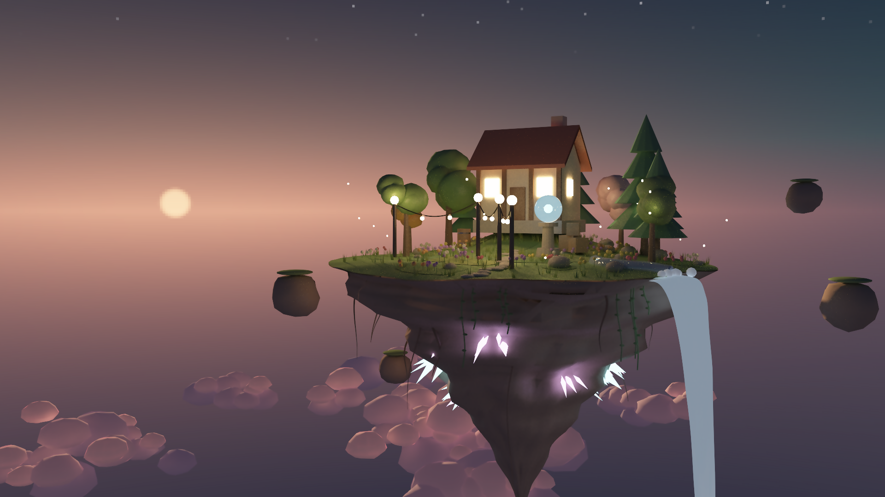

# Showcase: Lantern Isle



A floating island at dusk, just after sunset. A cottage glows from inside. A string of lanterns sags
between iron posts, and a glass orb holds a cyan seed of light. The lawn has tufts and flowers, with
pines, a blossom tree and an autumn tree. Under the rock, violet and cyan crystals glow among
hanging roots, and a waterfall pours off the edge toward a sea of cumulus far below.

Everything in the picture comes from one Lua scene script, [`lantern_isle.lua`](lantern_isle.lua),
and was rendered by Leorix Native's own CPU path tracer. Nothing was modelled by hand, painted over
or edited afterwards.

## How it was made

- **Terrain.** Value noise (fBm) written in the script shapes the grassy top, the rim and the layered
  rock underside, which tapers to a jagged point with strata bands. Darker and yellower lawn patches
  and a few hundred leaning grass blades break up the green.
- **Buildings and props.** Boxes, frusta and noise-displaced blobs built with `mesh()`, `m:vert()` and
  `m:face()`, placed in the cottage's own rotated frame. Crystals are six-sided spikes grown down and
  out from points on the underside.
- **Curves.** The lantern cable, the stream, the hanging roots and the vines are swept tubes made with
  `curve()`, Leorix's curve code with rotation-minimising frames, tapered with `taper`.
- **Materials.** `material{}` sets plaster, timber, roof tiles, iron, glass (`glass=1.5`), and the
  emissive windows, lanterns, crystals, orb seed and fireflies.
- **Light.** `world{preset="Dusk"}` is the built-in dusk sky: a navy zenith, teal mid-sky and a sunset
  glow on the horizon behind the island, with stars only in the dark upper sky. A low, warm sun from
  behind and to the left rims the roof, trees and rock edge. The sky fill is kept low so the windows
  and lanterns pool light on the lawn.
- **Glow without noise.** The clouds, waterfall, foam and orb glass glow softly but use
  `sample_light=false`. The tracer doesn't spend shadow rays on these large, dim surfaces, which keeps
  its light samples for the windows and lanterns.

## Re-render it

```sh
leorix.exe --headless-render docs/showcase/lantern_isle.lua hero.png --width 1920 --height 1080 --spp 2048 --denoise 1.5
```

This runs without opening a window or using the GPU. On a 16-thread desktop CPU it takes about
20 minutes; `--spp 256` gives a quick, grainier preview in a couple of minutes. Add
`--save lantern_isle.leorix` to also write the scene as a project. A copy is already here as
[`lantern_isle.leorix`](lantern_isle.leorix), so you can open it in the app and look around. The
project stores the objects, materials and camera; choose the Dusk environment to match the lighting.
